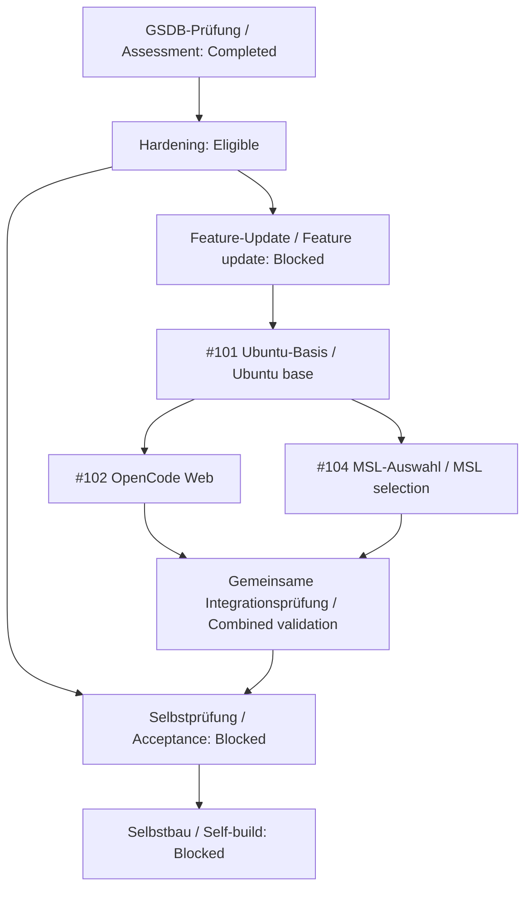

<!-- intake-authoring:begin -->
# Sandbox-Feature-Update: Ubuntu 26.04, OpenCode Web und MSL-Auswahl

**Status:** ReadyForReview
**Datum / Date:** 2026-10-28
**Profil / Profile:** deutsches Lastenheft gemäß `requirements/intake-governance-config.json`
**Quellen / Sources:** Issues [#101](https://github.com/hindermath/absdd-image-sandbox/issues/101), [#102](https://github.com/hindermath/absdd-image-sandbox/issues/102), [#104](https://github.com/hindermath/absdd-image-sandbox/issues/104), in dieser Reihenfolge / in this order.

## Deutsch

### 1. Zweck, Zielgruppe und Begriffe

Dieses Lastenheft bündelt den nächsten Feature-Update-Block in einem
Anforderungsdokument. Die Sandbox soll auf Ubuntu 26.04 wechseln, eine lokale
OpenCode-Weboberfläche anbieten und beim Image-Bau die benötigten
Programmiersprachen auswählen lassen. Die drei Issues bleiben die verlinkten
Arbeitsaufträge; der Block wird gemeinsam auf den finalen Images geprüft.

Die Zielgruppe beginnt im ersten Ausbildungsjahr: Fachinformatiker*innen
aller vier Fachrichtungen (Anwendungsentwicklung, Systemintegration, Daten-
und Prozessanalyse, Digitale Vernetzung), IT-System-Elektroniker*innen,
Kaufleute für IT-System-Management und Kaufleute für Digitalisierungsmanagement.
Lernbegleitung, Entwicklung, Betrieb und Security Review verwenden die
technischen Nachweise. Vorausgesetzt wird grundlegende Computerbedienung,
keine Container-, Programmier- oder Spec-Kit-Erfahrung.

#### Lesehilfe vor den Anforderungen

Die folgenden Begriffserklärungen gelten für das ganze Lastenheft. Sie
beschreiben die verwendeten Wörter und technischen Kennungen, keine neuen
Funktionen, Grenzwerte oder Berechtigungen.

| Begriff / Kennung | Erklärung |
|---|---|
| Image / Container | Ein Image ist eine Bauvorlage; ein Container ist die daraus gestartete isolierte Arbeitsumgebung. |
| Toolchain / MSL | Eine Toolchain bündelt die Werkzeuge einer Sprache. MSL bedeutet Memory-Safe Languages, hier .NET/C#, Java, Go, Rust, Python und Swift. |
| Profil / Build / Runtime | Ein Profil wählt Entwicklungswerkzeuge. Build bedeutet Image-Bau; Runtime bezeichnet die Laufzeit, in der Werkzeuge oder Container ausgeführt werden. |
| Ubuntu / LTS / Noble / Resolute | Ubuntu ist das Linux-Betriebssystem im Image. LTS bezeichnet eine langfristig gepflegte Ausgabe; Noble und Resolute sind Namen verschiedener Ubuntu-Ausgaben. |
| Host / Engine / Podman / Compose | Der Host ist der eigene Rechner. Die Engine betreibt Container, hier mit Podman. Compose beschreibt zusammengehörige Container und ihre Einstellungen. |
| CLI / TUI / Shell | CLI bedeutet Kommandozeilenbedienung; eine TUI ist eine textorientierte Terminaloberfläche. Eine Shell nimmt Befehle entgegen, etwa Bash oder PowerShell. |
| SDK / CPython / Infrastruktur | Ein SDK enthält Entwicklungswerkzeuge. CPython ist die hier gepinnte Python-Implementierung. Infrastruktur sind gemeinsame Hilfsprogramme, auch wenn ihre Sprache nicht als Entwicklungsprofil gewählt wurde. |
| LSP / Analysewerkzeug | LSP ist das Language Server Protocol: eine Schnittstelle für Editorhilfen wie Fehlermeldungen und Vervollständigung. Analysewerkzeuge untersuchen Quellcode oder Abhängigkeiten. |
| Mount / Bind-Mount / Volume | Ein Mount bindet Speicher in den Container ein. Ein Bind-Mount verbindet ein Host-Verzeichnis; ein Volume ist gesondert verwalteter dauerhafter Containerspeicher. |
| Mountwurzel / PATH / AppHost | Die Mountwurzel ist der Einstieg eines eingebundenen Verzeichnisses. PATH nennt Suchorte für Programme. AppHost ist eine von .NET erzeugte Startdatei für eine Anwendung. |
| bin / obj / Directory.Build.props | bin und obj enthalten .NET-Bauergebnisse und Zwischendateien. Directory.Build.props bündelt MSBuild-Einstellungen; ein Import lädt solche Einstellungen. Selbstimport bedeutet, dass eine Datei sich erneut selbst lädt. |
| AMD64 / ARM64 / nativ / Cross-Build | AMD64 und ARM64 sind Prozessorarchitekturen. Nativ bedeutet Ausführung auf der passenden Architektur. Ein Cross-Build baut für eine andere Zielarchitektur; Emulation bildet fremde Hardware nach. |
| Pin / Tag / Digest / SHA-256 | Ein Pin legt eine Version fest; ein Tag ist ein Versionsname. Ein Digest ist ein Inhaltsprüfwert. SHA-256 ist das hier verwendete Verfahren zur Bildung solcher Prüfwerte. |
| Multiarch / Image-ID / Manifest / Label | Multiarch beschreibt ein Imageangebot für mehrere Architekturen. Die Image-ID identifiziert ein lokales Image. Ein Manifest beschreibt zugehörige Inhalte; ein Label ist ein benanntes Metadatenfeld. |
| Rootless / Non-root / UID | Rootless bedeutet Betrieb der Container-Engine ohne Administratorrechte. Non-root bedeutet, dass der Prozess im Container nicht als root läuft. Eine UID ist die numerische Benutzerkennung. |
| Linux-Capabilities / Capability-Drop / CapEff | Linux-Capabilities sind einzeln vergebbare Systemrechte. Capability-Drop entfernt solche Rechte. CapEff zeigt die wirksamen Rechte als Bitmaske; der Wert 0 bedeutet keine wirksame Capability. |
| no-new-privileges / NoNewPrivs | no-new-privileges verhindert, dass ein Prozess über bestimmte Programmstarts neue Rechte erhält. NoNewPrivs ist das dazugehörige beobachtbare Prozessmerkmal; 1 zeigt die aktivierte Sperre. |
| SELinux / Bubblewrap / Seccomp | SELinux erzwingt zusätzliche Linux-Zugriffsregeln. Bubblewrap isoliert Prozesse und Dateisystemzugriffe. Seccomp beschränkt erlaubte Systemaufrufe; Standard-Seccomp meint das Standardprofil der Engine. |
| Policy / Hardening / Audit / Gate | Eine Policy legt Regeln fest. Hardening verringert unnötige Rechte und Angriffsflächen. Ein Audit prüft anhand von Nachweisen. Ein Gate ist eine Bedingung, die vor dem nächsten Schritt erfüllt sein muss. |
| localhost / Loopback / Port | localhost und Loopback bezeichnen die lokale Netzwerkschnittstelle. Ein Port ist eine nummerierte Dienstadresse; 5199 ist hier für OpenCode vorgesehen. |
| HTTP / Authentifizierung / 200 / 401 / 503 | HTTP überträgt Webanfragen. Authentifizierung prüft Zugangsdaten. Status 200 bedeutet Erfolg, 401 fehlende oder ungültige Anmeldung, 503 vorübergehende Nichtverfügbarkeit. |
| Healthcheck / Readiness / Timeout | Ein Healthcheck prüft den Dienst. Readiness bedeutet bereit für die vorgesehene Nutzung. Ein Timeout beendet das Warten nach einer festen Frist. |
| Entrypoint / Vordergrundprozess / Signal | Der Entrypoint ist das Startprogramm des Containers. Der Vordergrundprozess ist sein Hauptprogramm. Signale wie TERM fordern Programme zum Beenden auf; Signalweitergabe leitet sie an Kindprozesse weiter. |
| LF / .env / Umgebungsvariable / Secret | LF ist ein Zeilenendezeichen. Eine .env-Datei enthält lokale Variablenwerte; Umgebungsvariablen übergeben Einstellungen an Programme. Secrets sind vertrauliche Werte wie Passwörter oder Schlüssel. |
| Pairing / mDNS / Tunnel / CORS | Pairing koppelt Clients. mDNS findet Dienste im lokalen Netz. Ein Tunnel leitet Verbindungen weiter. CORS regelt, welche anderen Web-Ursprünge eine Browseranwendung ansprechen darf. |
| Sitzung / Fork / Standalone / Dispatcher | Eine Sitzung fasst zusammengehörige Agentenarbeit. Ein Sitzungs-Fork zweigt ihren Verlauf ab; ein Repository-Fork ist eine eigene Repository-Kopie. Standalone arbeitet ohne gemeinsamen Server; ein Dispatcher reicht Aufträge an die gewählte CLI weiter. |
| Provider / Modell / Inferenz | Ein Provider stellt einen KI-Dienst bereit. Ein Modell verarbeitet Eingaben; Inferenz ist ein tatsächlicher Modellaufruf. Ein lokales Webpasswort ist keine Anmeldung bei einem Provider. |
| SBOM / CycloneDX / Syft | Eine SBOM ist ein maschinenlesbares Software-Komponentenverzeichnis. CycloneDX ist dessen hier verwendetes Format. Syft ermittelt die Komponenten für dieses Verzeichnis. |
| Renovate / ARG / Regression / Pre-Commit | Renovate schlägt Versionsupdates vor. ARG benennt eine Dockerfile-Buildvariable. Eine Regression ist ein unbeabsichtigter Rückschritt; Regressionstests suchen danach. Pre-Commit führt Prüfungen vor einem Commit aus. |
| Git / Repository / Head / Commit / Push | Git verwaltet Dateiversionen; das Repository enthält deren Historie. Head bezeichnet den gewählten Commit. Ein Commit speichert einen Versionsstand; Push überträgt Commits an eine Gegenstelle. |
| Pull Request / Merge Request / Merge | Ein Pull oder Merge Request schlägt Änderungen zur Prüfung vor. Merge integriert geprüfte Änderungen in einen Zielbranch, also eine Entwicklungslinie. |
| Snapshot / Receipt / Provenienz / Git-Blob | Ein Snapshot hält einen gelesenen Stand fest. Ein Receipt protokolliert Herkunft und Prüfwerte. Provenienz macht die Änderungsgeschichte nachvollziehbar. Ein Git-Blob ist ein Inhaltsobjekt für Dateidaten. |
| Spec Kit / Intake / Review / Autonomous | Spec Kit ordnet Spezifikation, Planung und Aufgaben. Ein Intake ist ein Anforderungsdokument als Eingabe. Review prüft es; Autonomous bezeichnet einen gesondert autorisierten automatisierten Ablauf. |
| ReadyForReview / Ready / Enabled / LocalImplementation | ReadyForReview bedeutet zur Prüfung vorbereitet. Ready ist ein positives Inhaltsreview-Ergebnis. Enabled bedeutet kopierbare Prompt-Syntax. LocalImplementation begrenzt einen später genehmigten Lauf auf lokale Arbeit; keiner dieser Werte erteilt allein Startrechte. |
| Serie / Completed / Eligible / Blocked | Eine Serie ordnet abhängige Intakes. Completed bedeutet abgeschlossen, Eligible nächster Kandidat, Blocked durch Voraussetzungen gesperrt. Ein Kandidatenstatus ist keine Implementierungsfreigabe. |
| Open / Pass / Exitcode / SkipBuild | Open bedeutet noch offen, Pass eine belegte bestandene Prüfung. Der Exitcode ist der Rückgabewert eines Befehls, hier gewöhnlich 0 bei Erfolg. SkipBuild verwendet ein vorhandenes Image, das trotzdem geprüft werden muss. |
| GSDB / WSL2 / Mermaid | GSDB ist hier die generische Secure-Development-Basis aus Richtlinie und Checklisten. WSL2 führt Linux in einer Windows-Umgebung aus. Mermaid ist Textsyntax für ergänzende Diagramme. |
| CEFR B2 / A11Y / WCAG 2.2 AA | CEFR B2 bezeichnet ein Sprachniveau für verständliche selbständige Nutzung. A11Y steht für Barrierefreiheit. WCAG 2.2 AA ist die genannte Prüfbasis; Programmierung #include<everyone> bezeichnet den ergänzenden inklusiven Lernanspruch. |

### 2. Auftrag, Status und Rechte

Aktuell beauftragt sind die Aufnahme in die bestehende Reihe und die
Korrektur ihrer Statusansichten mit Provenienzpflege. Die frühere
IR701-Korrektur ist abgeschlossen. Ein neuer Reviewauftrag wird nur
vorbereitet; Implementierung und Remote-Schreiboperationen bleiben verboten.
ReadyForReview bedeutet inhaltlich bereit für ein separates Intake-Review,
keine bestandene Prüfung und keine Startfreigabe. Eine Implementierung,
ein bestehender Autonomous-Lauf, Containerbetrieb, Builds, Modellaufrufe,
Commit, Push, Pull Request, Merge oder Veröffentlichung werden hierdurch
nicht gestartet oder erlaubt.

`LocalImplementation` ist nur die vorbereitete Obergrenze eines später
gesondert autorisierten lokalen Laufs. Sie ist keine heutige Ausführungsfreigabe.
Der eigenständige Intake behält seine Identität; seine frühere redaktionelle
Fassung bleibt archiviert. Kein anderes Lastenheft wird ersetzt und die
fachlichen Anforderungen bleiben unverändert. Die Serie wird ausschließlich
um dieses Mitglied mit den dokumentierten Abhängigkeiten erweitert.

### 3. Ausgangslage und Quellenstand

Die drei am 2026-10-28 erneut gelesenen GitHub-Issues sind die fachlichen
Quellen. Unveränderte Titel-/Body-Snapshots liegen unter
`requirements/baseline/sandbox-feature-update-2026-10-28/`;
das aktualisierte Receipt bindet zuerst die archivierte Vorgängerfassung
und den autorisierten Aufnahmebeschluss, danach die bisherige Quellenkette
einschließlich IR701-Evidence und unveränderter Issue-Snapshots #101/#102/#104.
Alle Quellen sind per SHA-256 gebunden; die Issue-Reihenfolge bleibt erhalten.
Diese Snapshots beweisen die gelesenen Anforderungen, keine erfolgreiche
Produktprüfung. Verlinkte Quell-MRs und Berichte wurden in diesem
Erstellungsschritt nicht erneut abgerufen; ihr Status ist der datierte
Kontext aus den Issues vom 2026-10-27.

Danach verwendet das Zielrepo eine ältere .NET-/Ubuntu-Basis,
Noble-spezifische Swift-Prüfungen, Java 25, CPython 3.15 unter
`/opt/cpython`, OpenCode 2.1.4 und bereits Architektur-Guards.
Die Warteschleife hält den Container am Leben; eine Loopback-Portfreigabe
5100–5199 besteht. Die .NET-Ausgabeumleitung gilt nur unter
`/rider-projects/` und flacht Pfade mit Unterstrichen ab.
Dokumentationswerkzeuge und 14 Presets sind bereits vorhanden.

Die Issues binden den ADE-Quellkandidaten
`4a9eb43a8a11f0f5b30e7ec1ffd97064e1dd1e30` mit implementierten
MRs !70, !71 und !74; !76 dokumentiert den MSL-Alpha-Abschluss.
Der übergeordnete MR !64 war zum datierten Issue-Abgleich weiterhin Draft.
Quell-main enthielt die Anleitung, nicht diese Implementierungen.
Vor späterer Umsetzung müssen tatsächlicher Zielstand, Pins und Quellen
erneut geprüft werden. Quellversionen, Testzahlen und Image-IDs gelten
nicht automatisch als Nachweis für dieses Repo.

### 4. Zielzustand, Umfang und Nicht-Ziele

Das vollständige Standardprofil `all` erhält alle sechs Toolchains.
Sieben Build-Profile erlauben daneben .NET allein oder .NET plus eine
zusätzliche Sprache. Web, TUI und CLI nutzen denselben geschützten lokalen
OpenCode-Dienst. Bestehende Sicherheits-, Daten-, Audit- und Lernendenpfade
bleiben erhalten. Die gemeinsame Abnahme deckt die Kombination ab.

Umfang sind Basisimage, passende Sprach-Abhängigkeiten, mountunabhängige
.NET-Ausgaben, Web-/TUI-Anbindung, Profilwahl, zugehörige Wrapper, Tests,
Dokumentation und frische Nachweise. Die interne Umsetzung darf in
fokussierten Änderungen erfolgen: Basis zuerst, Web und Profile darauf
abstimmen, anschließend Integration prüfen.

Nicht-Ziele: Anbieter-/Modellrouting aus Quell-MR !68, neue Providerkonten,
echte Inferenz zur Pflichtprüfung, Docker als Zielruntime, globale
Systembereinigung, Volume-Reset, formelle Freigaben, Secret-Rotation,
Hosting-Regeln, Template-Aktivierung, Projekt-Images für Lernende oder
Ausführung anderer Lastenhefte. Bereits vorhandene Werkzeuge und Presets
werden abgeglichen statt erneut eingeführt.

### 5. Funktionale Anforderungen

**FU-001 – Basis:** Das finale Image MUSS Ubuntu 26.04 LTS und eine explizit
per Tag und Multiarch-Digest gebundene .NET-SDK-Basis für AMD64/ARM64 verwenden.
Der in #101 genannte Resolute-Kandidat ist vor Umsetzung zu verifizieren;
Tag, Digest und tatsächliche SDK-/PowerShell-Version müssen zusammenpassen.

**FU-002 – Abhängigkeiten:** Die Installation MUSS Ubuntu-26.04-kompatible
Pakete und Swift-Artefakte für beide Architekturen mit Integritätsprüfung
verwenden. Noble-spezifische Sperren und Meldungen müssen ersetzt werden.

**FU-003 – Versionsbestand:** Java 25, gepinntes CPython 3.15,
Ubuntu-System-Python und das vorhandene .NET-Kompatibilitäts-SDK MÜSSEN
erhalten bleiben, jeweils in den dafür vorgesehenen Profilen.
Quell-Java-21 oder Quell-OpenCode-2.1.3 dürfen keinen Downgrade auslösen.

**FU-004 – .NET-Ausgabe:** `bin`, `obj` und AppHost-Ausgaben MÜSSEN bei
allen unterstützten Projekt-Mountwurzeln unter `/dotnet-build` landen.
Unterschiedliche Verzeichnis- und Unterstrichpfade dürfen nicht kollidieren.
Projekt-`Directory.Build.props` müssen wirksam bleiben; Selbstimport ist
auszuschließen.

**FU-005 – Architektur:** Vorhandene Architektur-Guards MÜSSEN weiterverwendet
werden. Host, Engine, Ziel und finales Image müssen verglichen werden;
Cross-Builds sind ausdrücklich zu kennzeichnen und ersetzen keinen nativen Test.

**FU-006 – SELinux:** SELinux-/Bubblewrap-Verträglichkeit MUSS geprüft werden.
Eine nötige eng begrenzte Profilanpassung erfordert dokumentiertes
Sicherheitsreview; unbekannter Engine-Status darf nicht stillschweigend
akzeptiert werden. Capability-Drop, no-new-privileges, Standard-Seccomp und
innere Agent-Policy dürfen nicht für einen grünen Test gelockert werden.

**FU-007 – Webstart:** Der lokale OpenCode-Server MUSS die Warteschleife als
Vordergrundprozess ersetzen, im Container auf `0.0.0.0:5199` lauschen und
am Host ausschließlich über `127.0.0.1:5199` veröffentlicht werden.
Entrypoint, Signalweitergabe und Audit-Export beim Stop bleiben erhalten.

**FU-008 – Authentifizierung:** Eine lokale `OPENCODE_PASSWORD`-Konfiguration
MUSS mindestens 16 Zeichen verlangen und leere, kurze sowie bekannte
Platzhalterwerte ablehnen. Die tatsächlich gepinnte OpenCode-Version und
ihre Authentifizierungsvariable sind zu prüfen. Secrets dürfen nicht in
Argumenten, URLs, Logs, Testausgaben oder getrackten Dateien erscheinen.

**FU-009 – Readiness:** Der stille authentifizierte Healthcheck MUSS erst
bei betriebsbereitem geschütztem Endpunkt erfolgreich sein. Ein frühes 401
ist kein Readiness-Nachweis. Temporäres 503 beziehungsweise Verbindungsfehler
darf der Starttest nur mit fester Frist (Quellvertrag: 45 Sekunden)
wiederholen; andere HTTP-Fehler und ein Fristablauf müssen fehlschlagen.
Ausführbare Python-Healthchecks müssen auch aus Windows-Checkouts mit
korrekten LF-Zeilenenden funktionieren.

**FU-010 – Gemeinsame Clients:** Browser, TUI aus dem Projektverzeichnis und
nicht-interaktive CLI MÜSSEN denselben Server mit nachvollziehbarer
Projekt-/Sitzungszuordnung erreichen. Getrennte Sitzungen oder Forks dienen
gleichzeitigen Prompts; derselben Sitzung werden nicht gleichzeitig zwei
Prompts zugeführt. Standalone-Modus und Agent-Prompt-Dispatcher bleiben
verträglich.

**FU-011 – Portgrenze:** Port 5199 MUSS OpenCode vorbehalten bleiben.
Anwendungsbeispiele verwenden 5100–5198; bestehende Beispiele und Tests
müssen angepasst werden. Pairing, mDNS, Tunnel und zusätzliche CORS-Freigaben
werden nicht aktiviert. Parallel laufende Sandbox-Stacks erhalten klare
Portkonflikt-Hilfe.

**FU-012 – Profile:** Die feste Auswahl MUSS `dotnet`, `java`, `go`,
`rust`, `python`, `swift`, `all` umfassen. .NET/C# ist immer enthalten;
ein Einzelprofil fügt genau die benannte Toolchain hinzu. `all` enthält
alle sechs und bleibt der Standard bei Compose und direktem Build ohne
explizites Ziel.

**FU-013 – Profilwahl:** `ADE_MSL_PROFILE` in lokaler `.env` MUSS das
Compose-Buildziel `ade-<profil>` wählen. Ungültige Werte müssen vor dem
Build scheitern. Ein Profilwechsel erfordert Neubau und Container-Neuerstellung,
keinen Laufzeitschalter und keine Volume-Löschung.

**FU-014 – Profilidentität:** Image-Label mit generischem projektspezifischem
Namen, Laufzeitvariable und `/usr/local/share/ade/msl-profile.json` MÜSSEN
dasselbe Profil und dieselben Entwicklungs-/Infrastrukturbestandteile
ausweisen. Organisationsspezifische Quell-Labels sind kein Zielvertrag.

**FU-015 – Ausgewählte Werkzeuge:** Nur ausgewählte Entwicklungs-Toolchains
und ihre LSP-/Analysewerkzeuge DÜRFEN installiert sein. Nicht ausgewählte
dürfen auch nicht indirekt hineingelangen. Java- und Python-Entwicklung
verwenden den Zielrepo-Versionsbestand aus FU-003.

**FU-016 – Infrastruktur:** System-`python3`, Node/npm, PowerShell, uv,
alle vorhandenen Agenten einschließlich Gemini/Copilot, Spec Kit, 14 Presets,
Dokumentationswerkzeuge und Home-Baseline-/Runtime-Verträge MÜSSEN in jedem
Profil funktionieren. Infrastruktur-Python ist kein zugesagtes
Python-Entwicklungsprofil; `/opt/cpython` bleibt davon getrennt.
Webserver und Healthcheck gehören zum gemeinsamen Image-Kern.

**FU-017 – Wrapper-Parität:** Bash-/PowerShell-Build-/SBOM-Wrapper MÜSSEN
`--profile` beziehungsweise `-Profile`, Umgebungsvariable und `all`-Fallback
gleichwertig unterstützen und deren Präzedenz dokumentieren.
Auch SkipBuild muss das tatsächliche Image-Profil prüfen und bei Abweichung
scheitern. Profil und Architektur müssen im SBOM-Dateinamen erkennbar sein.

**FU-018 – Lieferkette:** Podman MUSS Zielruntime bleiben. SBOM-Erzeugung
verwendet imageintegriertes oder exakt gepinntes Host-Syft; bewegliche
Scanner-Fallbacks sind verboten. Pins, Renovate-ARG-Metadaten und
Dependency-Dokumentation müssen zusammenpassen.

**FU-019 – Daten und Audit:** Neustart und Profilwechsel MÜSSEN persistente
Daten erhalten. Normaler Stop läuft über den vorhandenen Audit-Wrapper.
Ein Exportfehler darf nicht umgangen werden. Exportiert werden nur erlaubte
Metadaten; `session_coverage=not-exported` bleibt für OpenCode-2-Datenbankmetadaten
sichtbar. Keine Datenbank-, Prompt-, Antwort- oder Secret-Inhalte exportieren.

**FU-020 – Sicherheitsbestand:** Non-root/rootless-Betrieb, `cap_drop: ALL`,
`no-new-privileges`, Standard-Seccomp und vorhandene Agent-Policies MÜSSEN
im finalen Standard- und Einzelprofil erhalten bleiben.

**FU-021 – Lernendenpfade:** Bestehende Markdown-Pfade in
`docs/fuer-lernende/` und `docs/betrieb/` sowie README, AGENTS und
Konfigurationsbeispiele MÜSSEN konsistent erweitert werden.
Deutsch steht zuerst, gleichwertiges Englisch folgt, ungefähr CEFR B2.
Begriffe werden beim ersten Gebrauch erklärt; keine zweite Lernreihe.

**FU-022 – Bedienbarkeit:** Anleitungen MÜSSEN Host/Container, Shell,
Voraussetzungen, erwartete Ergebnisse und Fehlerhilfe nennen, insbesondere
Passwortfehler/Restart-Schleife, Portkonflikt, Profilwechsel, Rückkehr zu
`all`, Speicherbedarf und sichere Recovery.
Ein erster gewählter Lernschritt muss ohne KI-Providerkonto möglich bleiben;
ein lokales Webpasswort ist kein Providerkonto. Schutzlockerung oder
Machine-/Volume-Löschung darf kein normaler Reparaturschritt sein.

**FU-023 – A11Y:** Tastaturbedienung, Fokusführung, Anmeldung und
Fehlermeldungen MÜSSEN gegen die anwendbaren WCAG-2.2-AA-Kriterien und
`Programmierung #include<everyone>` geprüft werden. Abhängigkeiten,
Zustände, Entscheidungen und nächste Schritte benötigen vollständigen Text.
Automatische Markdown-/HTTP-Prüfungen sind keine A11Y-Abnahme.

### 6. Abnahme und erforderliche Nachweise

| ID | Messbares Kriterium |
|---|---|
| FA-001 | Frischer Basis-Build, OS-/SDK-/PowerShell-Prüfung, verifizierte Downloads, Pins und Guards bestehen; Versionsbestand FU-003 bleibt im jeweiligen Profil erhalten. |
| FA-002 | Zwei verschiedene Mountwurzeln sowie Verzeichnis-/Unterstrich-Kollisionsfälle bauen ohne Ausgaben auf Bind-Mounts; Projekt-Props und AppHost werden geprüft. |
| FA-003 | Alle sieben Profile bauen und laufen nativ auf AMD64 und ARM64. Positive/negative Werkzeugprüfungen und kleine ausführbare Sprachprojekte bestehen je Profil. |
| FA-004 | CLI-/Umgebungs-/Standardauswahl ist dokumentiert und in beiden Wrappern gleich; ungültiges Profil und Image-/Profilabweichung, auch mit SkipBuild, scheitern. |
| FA-005 | Synthetische Passwortfälle bestehen: leer/kurz/Platzhalter abgelehnt, ungültige Anmeldung 401, gültige Anmeldung 200. Temporäres 503 wird nur begrenzt wiederholt; dauerhaftes 503 scheitert. Healthcheck bleibt secretfrei. |
| FA-006 | Hostbrowser-Anmeldung tatsächlich beobachtet; TUI und CLI erreichen dasselbe Testprojekt und passende Sitzungen ohne echte API-Keys oder Inferenz. |
| FA-007 | Praktischer Compose-Neubau/Start/Profilwechsel/Neustart sowie Audit-Stop bestehen mindestens mit dotnet und all. Daten und Volumes bleiben erhalten; Exportfehler blockiert den Standard-Stop. |
| FA-008 | Gemeinsame Build-Gates gelten für alle Profile; volle Policy-/Audit-/Dokumentationssuite mindestens für dotnet und all. Non-root, CapEff=0, NoNewPrivs=1, Standard-Seccomp und innere Policy sind belegt. |
| FA-009 | macOS/ARM64, Windows/AMD64 und Ubuntu/WSL2 werden getrennt dokumentiert; Direktbuild ist kein Compose-Nachweis, Emulation kein nativer Nachweis. Fehlende oder rote Gates bleiben Open/Blocked. |
| FA-010 | Je auszulieferndem Profil und Architektur liegt eine frische CycloneDX-SBOM mit Datum, Git-Head, Image-ID und Hash vor. Dateinamen unterscheiden Profil/Architektur; Größen sind gemessen und imagegebunden. |
| FA-011 | Relevante Regressionen, secretfreie Compose-Validierung, Pre-Commit, Secret-Scan und diff-Prüfung bestehen; DE/EN-Leserpfade und anwendbare A11Y-Prüfungen sind dokumentiert. |
| FA-012 | Alle drei Issue-Anforderungsteile und ihre Integration sind auf demselben finalen Quellstand geprüft. Kein Issue oder Gesamtblock wird allein durch Quellberichte oder Artefaktvalidatoren als erledigt ausgegeben. |

Jeder Nachweis nennt Datum, Profil, Git-Head, Host/Engine/Ziel/Image-Architektur,
Image-ID, Befehle und Exitcodes sowie Grenzen. Generierte SBOMs bleiben
ungetrackt, sofern kein späterer Releaseauftrag anders entscheidet.
Betriebs-, Produkt-, A11Y- und formelle menschliche Freigaben bleiben
unterschiedliche Aussagen. Der hier geforderte Nachweis ist erst später
auszuführen; diese Datei behauptet keinen Pass.

### 7. Verbindliche Einordnung in die Lastenheft-Reihe

**Aufnahmeentscheidung vom 2026-10-28:** Dieses Lastenheft gehört nach dem
bestehenden Container-Hardening und vor die unabhängige Sandbox-Selbstprüfung.
Damit prüft die Selbstprüfung die fertige neue Basis einschließlich
Web-Angriffsfläche und Sprachprofilen. Kein Lauf wird dadurch gestartet.

Verbindliche sichtbare Reihenfolge gemäß Serienmanifest:

1. `Lastenheft_GSDB-Spec-Kit-Intensivpruefung.md` (archivierte Root, Completed).
2. `Lastenheft_Secure-Development-Container-Hardening.md` (Eligible).
3. Dieses Lastenheft als gemeinsamer Feature-Update-Block (Blocked).
4. `Lastenheft_Sandbox-Secure-Development-Selbstpruefung.md` (Blocked).
5. `intakes/learner-fork-self-build-sandbox.md` (Blocked).

Innerhalb von Schritt 3 liefert #101 die Basis, #102 und #104 werden darauf
abgestimmt; der gemeinsame Abschluss umfasst die gesamte Kombination.
Das Update muss Hardening-Ergebnisse erhalten und relevante
Security-/Audit-/Plattformtests auf dem neuen Image erneut bestehen.
Neue Lücken werden vor Selbstprüfung behoben oder bleiben ausdrücklich blockiert.

Maßgeblich ist `specs/intake-series/sandbox-development-lifecycle/manifest.json`:
Completed → Eligible → Blocked → Blocked → Blocked mit fünf Mitgliedern.
Einzige Root bleibt die abgeschlossene GSDB-Prüfung. Die drei bisherigen
bindenden Kanten bleiben bestehen. Zusätzlich bindet Hardening →
Feature-Update die vorausgesetzte Sicherheitsbaseline; Feature-Update →
Selbstprüfung bindet das finale Update-Image. Die Selbstprüfung verlangt
damit ausdrücklich sowohl Hardening als auch Feature-Update.
Die Selbstbau-Vorlage bleibt von erfolgreicher Selbstprüfung abhängig.

Dieses Lastenheft erhält keine Eligible-Einstufung und keine Startfreigabe.
Die frühere viergliedrige Serienprüfung und das frühere Single-Review
bleiben als historische Ready-Nachweise archiviert; sie gelten nicht als
neues Vollreview der aufgenommenen Fassung. Der neue fünfgliedrige
Reviewauftrag ist separat vorbereitet und noch nicht ausgeführt.

#### Ergänzendes Ablaufdiagramm / Supporting flow diagram

DE: Das Diagramm wiederholt die bindenden Abhängigkeiten aus dem Text.
Hardening bleibt zusätzlich direkter Vorgänger der Selbstprüfung.
Innerhalb des Updates ist #101 die Grundlage für #102 und #104;
anschließend folgt die gemeinsame Integrationsprüfung.

EN: The diagram repeats the binding textual dependencies. Hardening remains
a direct predecessor of acceptance as well. Inside the update, #101 supports
#102/#104 before combined integration validation. Text remains the full alternative.



### 8. Abgrenzung der Quellen und erwartete Artefakte

| Quelle | Abgedeckte Anforderungen | Abnahme |
|---|---|---|
| #101 | FU-001–006, FU-018, Basis-/Versionsschutz und .NET-Ausgabepfade | FA-001–003, FA-008–012 |
| #102 | FU-007–011, FU-019–023, gemeinsamer Webbetrieb | FA-005–009, FA-011–012 |
| #104 | FU-012–018, gemeinsame Infrastruktur und Profilnachweise | FA-003–004, FA-007–012 |

Gemeinsame Schutz-, Lernenden- und Lieferkettenanforderungen gelten
quellenübergreifend. Erwartete spätere Artefakte sind angepasste
Image-/Compose-Konfiguration, Wrapper und Profile, Manifest/Label-Vertrag,
Regressionen, Reader-Dokumentation, aktuelle Prüfmatrix, Image-/Profilnachweise,
SBOMs und eine Abschlusszuordnung zu allen drei Issues.
Spezifikation, Plan und Tasks entstehen erst durch spätere eigene Aufträge.

### 9. Risiken, Annahmen und offene Entscheidungen

Basiswechsel und bedingte Installation können Bibliotheken, Laufzeit-PATH,
native Tests oder gemeinsame Werkzeuge beeinträchtigen. Der Webstart kann
ohne lokales Passwort in eine Restart-Schleife geraten. Profil-/Image-Tags
können verwechselt werden; daher manifest-/labelgebundene Prüfungen.
Quellbelege können ältere Testcommits betreffen. Begrenzte Plattformkapazität
ist kein Grund, fehlende Nachweise als bestanden auszugeben.

Die drei Issues sind durch Nutzerauftrag ein gemeinsamer Block; keine
Aufteilung in drei neue Intakes. Es gibt keine offene fachliche Entscheidung,
die die Erstellung dieses Lastenhefts blockiert. Die Serienaufnahme ist
autorisiert und dokumentiert; Review und Ausführungsfreigabe bleiben getrennt.
Der genaue generische Labelname, interne Schichtung und Wrapper-Präzedenz
werden in späterer Planung unter den obigen Verträgen festgelegt.

<!-- intake-authoring:prompts -->
## Vorbereitete spätere Spec-Kit-Prompts / Prepared Future Spec Kit Prompts

DE: Die folgenden Vorlagen werden jetzt nicht ausgeführt. Zuerst ist ein
neues Vollreview der aufgenommenen Reihe nötig; der Start benötigt weiterhin
eigene Autorität. PromptState Enabled bedeutet kopierbare Syntax, keine
Ausführungsberechtigung.

EN: Do not execute these templates now. First perform a separate intake
full review of the admitted series; execution still needs its own authority.
Enabled means copy-ready syntax rather than permission.

<!-- spec-kit-command-id: speckit.specify -->
### Specify

```text
$speckit-specify Erstelle nur nach gesondertem Auftrag eine Spezifikation aus Lastenheft_Sandbox-Feature-Update-Ubuntu2604-OpenCode-Web-MSL.md. Bewahre FU-001 bis FU-023, FA-001 bis FA-012 und die Quellen #101/#102/#104 als einen gemeinsamen Feature-Update-Block. Beachte Hardening-Erhalt, DE/EN-Leserpfade, A11Y, Plattform- und Daten-/Audit-Grenzen. Die Serienposition ist genehmigt; das neue Serienreview ist noch ausstehend. Keine Implementierung, kein Build, Containerstart, Commit, Push, Pull Request, Merge oder sonstige Remote-Schreiboperation.
```

<!-- spec-kit-command-id: speckit.autonomous -->
### Autonomous

```text
$speckit-autonomous Starte einen Lauf für Lastenheft_Sandbox-Feature-Update-Ubuntu2604-OpenCode-Web-MSL.md ausschließlich nach gesonderter ausdrücklicher Startfreigabe, aktuellem Intake-Review, geklärter Serienaufnahme und Abschluss der genehmigten Vorgänger. Delivery Authority LocalImplementation ist die maximale lokale Obergrenze; dieser vorbereitete Prompt erteilt selbst keine Startautorität. Bewahre sämtliche FU-/FA-Verträge und bestehende Sicherheits-/Human-Gates. Keine bestehenden Läufe automatisch fortsetzen. Stoppe vor Commit, Push, Pull Request, Merge, Veröffentlichung, Provider-/Secret- oder Plattformänderungen.
```

## English

### Purpose, audience and authority

This intake combines issues #101, #102 and #104 into one coordinated sandbox
update: Ubuntu 26.04, local OpenCode Web and selectable development toolchains.
The audience starts in year one and covers all four IT-specialist tracks,
IT systems electronics technicians and both IT management training occupations,
plus instructors, developers, operations and security reviewers.
Only basic computer use is assumed; no container, programming or Spec Kit
experience is required.

#### Reader help before the requirements

The following glossary applies throughout this intake. It explains the terms
and technical identifiers, without adding functions, thresholds or authority.
It is equivalent to the German glossary.

| Term / identifier | Explanation |
|---|---|
| Image / Container | An image is a build template; a container is the isolated working environment started from it. |
| Toolchain / MSL | A toolchain groups a language's tools. MSL means Memory-Safe Languages, here .NET/C#, Java, Go, Rust, Python and Swift. |
| Profil / Build / Runtime | A profile selects development tools. Build means creating the image; runtime is the environment in which tools or containers run. |
| Ubuntu / LTS / Noble / Resolute | Ubuntu is the Linux operating system in the image. LTS denotes a long-term-supported release; Noble and Resolute name different Ubuntu releases. |
| Host / Engine / Podman / Compose | The host is your computer. The engine runs containers, here using Podman. Compose describes related containers and their settings. |
| CLI / TUI / Shell | CLI means command-line operation; a TUI is a text-based terminal interface. A shell accepts commands, for example Bash or PowerShell. |
| SDK / CPython / Infrastruktur | An SDK contains development tools. CPython is the Python implementation pinned here. Infrastructure means shared supporting programs, even when their language is not selected for development. |
| LSP / Analysewerkzeug | LSP is the Language Server Protocol, an interface for editor features such as diagnostics and completion. Analysis tools inspect source code or dependencies. |
| Mount / Bind-Mount / Volume | A mount makes storage available inside a container. A bind mount connects a host directory; a volume is separately managed persistent container storage. |
| Mountwurzel / PATH / AppHost | A mount root is the entry path of mounted storage. PATH lists program search locations. AppHost is a .NET-generated launcher for an application. |
| bin / obj / Directory.Build.props | bin and obj hold .NET outputs and intermediate files. Directory.Build.props shares MSBuild settings; an import loads those settings. Self-import means a file loads itself again. |
| AMD64 / ARM64 / nativ / Cross-Build | AMD64 and ARM64 are processor architectures. Native execution uses the matching architecture. A cross-build targets a different architecture; emulation simulates other hardware. |
| Pin / Tag / Digest / SHA-256 | A pin fixes a version; a tag is a version name. A digest identifies content. SHA-256 is the method used here to calculate such hashes. |
| Multiarch / Image-ID / Manifest / Label | Multiarch describes images for multiple architectures. The image ID identifies a local image. A manifest describes associated content; a label is a named metadata field. |
| Rootless / Non-root / UID | Rootless means running the container engine without administrator privileges. Non-root means the process inside the container does not run as root. A UID is a numeric user identifier. |
| Linux-Capabilities / Capability-Drop / CapEff | Linux capabilities are individually assignable system privileges. Capability drop removes them. CapEff reports effective privileges as a bitmask; 0 means no effective capability. |
| no-new-privileges / NoNewPrivs | no-new-privileges prevents a process from gaining privileges through certain program launches. NoNewPrivs is the observable process flag; 1 indicates that the restriction is enabled. |
| SELinux / Bubblewrap / Seccomp | SELinux enforces additional Linux access rules. Bubblewrap isolates processes and file-system access. Seccomp restricts allowed system calls; standard Seccomp means the engine's default profile. |
| Policy / Hardening / Audit / Gate | A policy defines rules. Hardening reduces unnecessary privileges and attack surfaces. An audit checks evidence. A gate is a condition that must be met before the next step. |
| localhost / Loopback / Port | localhost and loopback refer to the local network interface. A port is a numbered service endpoint; 5199 is assigned to OpenCode here. |
| HTTP / Authentifizierung / 200 / 401 / 503 | HTTP carries web requests. Authentication checks credentials. Status 200 means success, 401 means missing or invalid authentication, and 503 means temporary service unavailability. |
| Healthcheck / Readiness / Timeout | A healthcheck checks the service. Readiness means it is ready for the intended use. A timeout stops waiting after a fixed deadline. |
| Entrypoint / Vordergrundprozess / Signal | The entrypoint is the container's startup program. The foreground process is its main program. Signals such as TERM request termination; signal forwarding passes them to child processes. |
| LF / .env / Umgebungsvariable / Secret | LF is a line-ending character. A .env file stores local variable values; environment variables pass settings to programs. Secrets are confidential values such as passwords or keys. |
| Pairing / mDNS / Tunnel / CORS | Pairing links clients. mDNS discovers local-network services. A tunnel forwards connections. CORS controls which other web origins a browser application may access. |
| Sitzung / Fork / Standalone / Dispatcher | A session groups related agent work. A session fork branches its history; a repository fork is a separate repository copy. Standalone runs without a shared server; a dispatcher forwards requests to the selected CLI. |
| Provider / Modell / Inferenz | A provider supplies an AI service. A model processes input; inference is an actual model call. A local web password is not a provider sign-in. |
| SBOM / CycloneDX / Syft | An SBOM is a machine-readable software component inventory. CycloneDX is the format used here. Syft identifies components for that inventory. |
| Renovate / ARG / Regression / Pre-Commit | Renovate proposes dependency updates. ARG declares a Dockerfile build variable. A regression is an unintended loss of behavior; regression tests detect it. Pre-Commit runs checks before a commit. |
| Git / Repository / Head / Commit / Push | Git manages file versions; the repository contains their history. Head identifies the selected commit. A commit records a revision; push transfers commits to a remote. |
| Pull Request / Merge Request / Merge | A pull or merge request proposes changes for review. Merge integrates reviewed changes into a target branch, which is a development line. |
| Snapshot / Receipt / Provenienz / Git-Blob | A snapshot captures the version read. A receipt records origins and hashes. Provenance makes change history traceable. A Git blob is a content object for file data. |
| Spec Kit / Intake / Review / Autonomous | Spec Kit organizes specification, planning and tasks. An intake is a requirements document used as input. Review assesses it; Autonomous denotes a separately authorized automated workflow. |
| ReadyForReview / Ready / Enabled / LocalImplementation | ReadyForReview means prepared for review. Ready is a positive content-review outcome. Enabled means copy-ready prompt syntax. LocalImplementation limits a later authorized run to local work; none of these values alone grants execution authority. |
| Serie / Completed / Eligible / Blocked | A series orders dependent intakes. Completed means finished, Eligible means next candidate, and Blocked means prerequisites prevent progress. Candidate status is not implementation authority. |
| Open / Pass / Exitcode / SkipBuild | Open means unresolved; Pass means a verified successful check. The exit code is a command's return value, normally 0 on success here. SkipBuild uses an existing image that still needs verification. |
| GSDB / WSL2 / Mermaid | GSDB is the generic secure-development guideline and checklist baseline here. WSL2 runs Linux in a Windows environment. Mermaid is text syntax for supporting diagrams. |
| CEFR B2 / A11Y / WCAG 2.2 AA | CEFR B2 is a language level for understandable independent use. A11Y means accessibility. WCAG 2.2 AA is the stated review baseline; Programmierung #include<everyone> denotes the additional inclusive-learning aim. |


ReadyForReview means ready for a separate requirements review. The current
request authorizes series admission and corrected status views with
provenance only. IR701 repair is complete; a new review request is prepared,
not executed. No implementation or remote mutation is authorized.
No implementation, build, runtime, inference, commit, push or remote write
is authorized. LocalImplementation is merely the maximum prepared scope of a
separately authorized future run. This intake retains its identity and its
predecessor is archived; no other intake is superseded.

### Source and target

The three issues were read again on 2026-10-28; ordered title/body snapshots
and receipt hashes bind #101, #102 and #104. The updated receipt first binds
the archived predecessor and authorized admission decision, then the existing
source chain with IR701 evidence and unchanged issue snapshots in original order. Their linked ADE candidate
and reports are dated context from 2026-10-27, not freshly checked upstream
status. Recheck actual target/source versions before implementation.
Source Java 21/OpenCode 2.1.3 and historical test results do not replace
this repo's Java 25/CPython 3.15/OpenCode 2.1.4 or fresh acceptance.

Keep all six toolchains in default profile all. Other profiles contain .NET
plus no or one selected additional language. Browser, TUI and CLI share the
local authenticated service. Retain security, persistent data, audit and
existing learning paths. Exclude source provider/model routing, new accounts,
mandatory live inference, Docker runtime, destructive cleanup, formal approval,
secret rotation, platform rules, template activation and unrelated intakes.

### Equivalent requirements

| ID | Required outcome |
|---|---|
| FU-001 | Ubuntu 26.04 with an explicit tag/digest-bound native AMD64/ARM64 .NET base; verify candidate availability and actual SDK/PowerShell versions. |
| FU-002 | Matching Ubuntu dependencies and integrity-checked Swift artifacts for both architectures; remove Noble-only guards. |
| FU-003 | Preserve target Java 25, pinned CPython 3.15, separate system Python and compatibility SDK in appropriate profiles; no source-driven downgrade. |
| FU-004 | Redirect bin/obj/AppHost from every supported project mount to /dotnet-build without path collisions; preserve repository props and prevent self-import. |
| FU-005 | Reuse architecture guards; distinguish host, engine, target and image, and label cross-builds separately from native proof. |
| FU-006 | Review SELinux/Bubblewrap compatibility, fail on unknown status and review narrow adjustments; do not weaken capability, privilege, Seccomp or inner policy controls. |
| FU-007 | Replace idle loop with the foreground web server, listen on container 0.0.0.0:5199, publish only host 127.0.0.1:5199, preserve entrypoint/signals/audit. |
| FU-008 | Require a local password of at least 16 characters, reject missing/short/placeholder values, verify target auth semantics and never expose secrets. |
| FU-009 | Silent authenticated readiness; 401 alone is insufficient. Retry temporary 503/connection errors only within a fixed deadline (source contract: 45 seconds); fail other errors/timeouts. Support LF healthchecks from Windows checkouts. |
| FU-010 | Browser, project-directory TUI and CLI share a server with correct project/session mapping; use separate sessions/forks for concurrent prompts and retain standalone/dispatcher compatibility. |
| FU-011 | Reserve 5199; use 5100–5198 for examples. No pairing, mDNS, tunnels or extra CORS. Explain concurrent-stack conflicts. |
| FU-012 | Provide dotnet/java/go/rust/python/swift/all; .NET always remains, single profiles add just the named language, all preserves six as Compose/direct-build default. |
| FU-013 | Local ADE_MSL_PROFILE selects ade-<profile>; reject invalid values before build. Switching requires rebuild/recreation while preserving volumes. |
| FU-014 | Keep generic project label, runtime variable and /usr/local/share/ade/msl-profile.json consistent, distinguishing development and infrastructure. |
| FU-015 | Install selected development tools/LSP/analysis only, without indirect excluded toolchains; preserve target versions. |
| FU-016 | Retain system python3, Node/npm, PowerShell, uv, all agents including Gemini/Copilot, Spec Kit, 14 presets, documentation tools and Home Baseline/runtime contracts in every profile; distinguish /opt/cpython development from infrastructure and keep web/health in the shared core. |
| FU-017 | Give Bash/PowerShell matching profile options, environment/default behavior and documented precedence; verify actual image profile even with SkipBuild; distinguish profile/architecture in SBOM filenames. |
| FU-018 | Keep Podman, integrated or exactly pinned host Syft without moving fallback; align version pins, Renovate metadata and dependency guidance. |
| FU-019 | Preserve data across restart/profile changes and use audited normal shutdown; do not bypass export failure. Export permitted metadata only; retain session_coverage=not-exported and never export database/prompt/response/secret contents. |
| FU-020 | Retain rootless/non-root, cap_drop ALL, no-new-privileges, standard Seccomp and existing agent policies across profiles. |
| FU-021 | Extend existing learner/operations paths, README, AGENTS and examples; German first/equivalent English around B2, explain terms, no second learning series. |
| FU-022 | Explain location, shell, prerequisites, results and recovery, including password/restart, port conflict, profile switching/all and storage. Preserve an initial learning step without a provider account; local web credentials are separate. Never make machine/volume deletion or safeguard bypass normal recovery. |
| FU-023 | Review keyboard/focus/login/errors against applicable WCAG 2.2 AA and Programmierung #include<everyone>; provide full textual states/dependencies/decisions/actions. Automated checks do not establish accessibility acceptance. |

### Acceptance and evidence

FA-001 verifies the fresh base, versions, artifacts and guards; FA-002 tests
two mount roots, path collisions, props and AppHost outside bind mounts.
FA-003 requires all seven native AMD64/ARM64 builds/runs, selected/excluded
tools and executable examples. FA-004 checks selection parity, invalid values
and mismatched images including SkipBuild. FA-005 tests synthetic password
rejection, HTTP 401/200, bounded 503 retries and silent health.
FA-006 requires actual browser login plus TUI/CLI project/session checks
without live credentials or inference. FA-007 checks real Compose lifecycle,
profile switching, persistence and audit shutdown for dotnet/all, including
export failure blocking normal stop. FA-008 checks common build gates across
all profiles and full policy/audit/documentation suites for dotnet/all, with
non-root, CapEff=0, NoNewPrivs=1, Seccomp and inner-policy evidence.
FA-009 separates macOS/ARM64, Windows/AMD64 and Ubuntu/WSL2, direct build
versus Compose and native versus emulated proof. Missing/red gates stay open.
FA-010 requires fresh image/profile/architecture-bound CycloneDX SBOMs and
measured sizes. FA-011 covers relevant regressions, secret-safe Compose,
Pre-Commit, secret/diff checks, bilingual reader paths and applicable A11Y.
FA-012 requires integrated acceptance of all three issue scopes on the same
final source revision.

Record date, profile, Git revision, host/engine/target/image architecture,
image ID, commands/exits and limitations. Keep generated SBOMs untracked
unless a later release explicitly requires otherwise. Source reports and
artifact validators are no target product/security/accessibility acceptance.
Formal human decisions remain separate and are not claimed here.

### Binding series position and risks

The user authorized admission on 2026-10-28: assessment (Completed),
hardening (Eligible), this update (Blocked), acceptance (Blocked), self-build
(Blocked). The archived assessment remains the sole root. All three previous
binding edges remain; add hardening → update and update → acceptance.
Acceptance therefore requires both hardening and the complete update.
Self-build still requires successful acceptance.

Preserve hardening results and repeat affected security/audit/platform tests
on the updated image. Inside this block #101 provides the base; align #102/#104
and validate the whole combination. Admission grants neither eligibility
nor execution authority. The previous four-member Ready review and prior
Single Ready review are archived historical evidence; neither is a new full
review of the admitted version. A fresh five-member review request is
prepared but not executed.

The source mapping table above binds #101 to FU-001–006/FU-018, #102 to
FU-007–011/FU-019–023, and #104 to FU-012–018 with shared safeguards throughout.
Expected future artifacts are configuration, wrappers/profiles, label/manifest
contract, regressions, reader guidance, verification matrix, fresh image/SBOM
evidence and final three-issue traceability. Spec/plan/tasks require later work.

Risks include library/PATH incompatibility, indirect tool installation,
password restart loops, image/profile confusion, historical source evidence
and unavailable platforms. None permits weakening controls or inventing Pass.
The user explicitly requested one combined intake. No unresolved requirement
blocks its creation; series admission is authorized, while new review and start
remain separate later steps,
while internal layering, generic label naming and wrapper precedence belong
to later planning within these requirements.
<!-- intake-authoring:end -->
