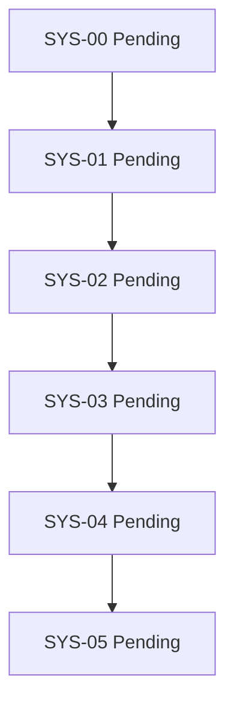

# SysInfo-Reihe / SysInfo Series

**DE:** Das JSON-Manifest ist maßgeblich. Die Serie ist Draft. Alle sechs
Knoten sind Pending; es gibt keine bisherige Abnahme. Jede Kante bedeutet
HardCompletionGate: Vorgänger menschlich abgenommen und Nachweise aktuell,
bevor der Nachfolger gestartet werden darf. Nur SYS-00 hat keinen Vorgänger,
braucht aber Serienreview, Sprachwahl und eigenen Startauftrag.

**EN:** JSON is authoritative. Series Draft, all six nodes Pending; no previous
acceptance. Every edge is a binding HardCompletionGate: human acceptance and
current evidence before progression. SYS-00 has no predecessor but still needs
series review, language selection and explicit authority.

| Knoten / Node | Status | Vorgänger / Predecessor | Ziel / Goal |
|---|---|---|---|
| [SYS-00](intakes/00-cli.md) | Pending | keiner / none | CLI, JSON/CSV/XML |
| [SYS-01](intakes/01-yaml.md) | Pending | SYS-00 | YAML |
| [SYS-02](intakes/02-sqlite.md) | Pending | SYS-01 | SQLite |
| [SYS-03](intakes/03-rest.md) | Pending | SYS-02 | REST |
| [SYS-04](intakes/04-dokumentation.md) | Pending | SYS-03 | Dokumentation / documentation |
| [SYS-05](intakes/05-review.md) | Pending | SYS-04 | Evidenzreview / evidence review |

**DE:** Kein Produktlauf gestartet. Nächster Schritt im persönlichen Repo:
ganze Serie anhand des mitgelieferten Review-Requests prüfen lassen.
**EN:** No product run started. Next personal step: review the complete series
using the supplied request, not launch a later stage.
