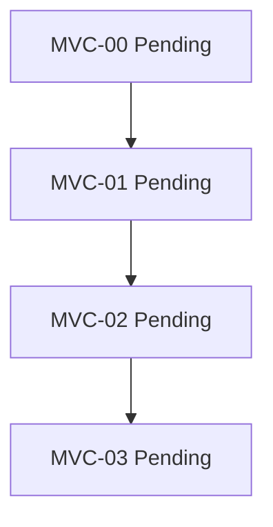

# MVC-Reihe / MVC Series

**DE:** JSON ist maßgeblich. Serie Draft, jeder Knoten Pending. Alle Kanten
sind HardCompletionGate: fachliche Abnahme des Vorgängers und aktuelle
Nachweise vor dem Nachfolger. MVC-00 braucht Entscheidung A, Serienreview und
Startauftrag; kein anderer Web-Pfad ist Voraussetzung.

**EN:** JSON governs. Series Draft, every node Pending. All edges require human
acceptance and current evidence before progression. MVC-00 needs route-A
decision, series review and start authority; no other web route is required.

| Knoten / Node | Status | Vorgänger / Predecessor | Ziel / Goal |
|---|---|---|---|
| [MVC-00](intakes/00-formular.md) | Pending | keiner / none | Formular mit Fixtures / fixture form |
| [MVC-01](intakes/01-crud.md) | Pending | MVC-00 | SQLite-CRUD |
| [MVC-02](intakes/02-fehler-und-bedienung.md) | Pending | MVC-01 | Fehler und Bedienung / errors and usability |
| [MVC-03](intakes/03-abschluss.md) | Pending | MVC-02 | Dokumentation und Review / documentation and review |

**DE:** Als Nächstes die persönliche Entscheidung ausfüllen und die gesamte
Serie reviewen lassen. Kein Produktlauf begonnen.
**EN:** Next, record the personal decision and review the entire series.
No product execution has begun.
