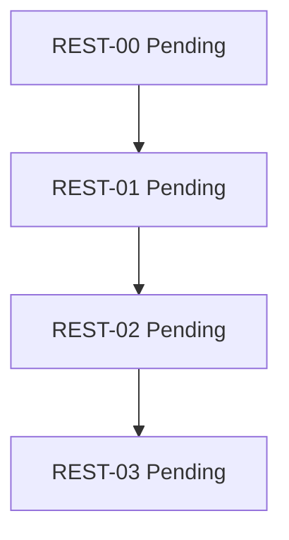

# MVC-REST-Reihe / MVC REST Series

**DE:** JSON ist maßgeblich. Serie Draft, alle Knoten Pending. Jede Kante ist
HardCompletionGate: menschliche Abnahme und aktuelle Nachweise vor Übergang.
REST-00 braucht Entscheidung B, Serienreview und persönlichen Startauftrag.
Weg A ist weder Voraussetzung noch bereits abgeschlossen.

**EN:** JSON governs. Series Draft, all nodes Pending. Every edge requires
human acceptance and current evidence before progression. REST-00 needs route-B
decision, series review and explicit authority. Route A is not a prerequisite.

| Knoten / Node | Status | Vorgänger / Predecessor | Ziel / Goal |
|---|---|---|---|
| [REST-00](intakes/00-vertrag.md) | Pending | keiner / none | API-Vertrag und Fixtures / API contract and fixtures |
| [REST-01](intakes/01-sqlite.md) | Pending | REST-00 | Persistente API / persistent API |
| [REST-02](intakes/02-mvc-client.md) | Pending | REST-01 | MVC-Client |
| [REST-03](intakes/03-abschluss.md) | Pending | REST-02 | Dokumentation und Review / documentation and review |

**DE:** Nächster persönlicher Schritt: Entscheidung ausfüllen, dann gesamtes
Serienreview beauftragen. Kein Produktlauf gestartet.
**EN:** Next personal step: record the decision, then request full-series review.
No product execution has begun.
