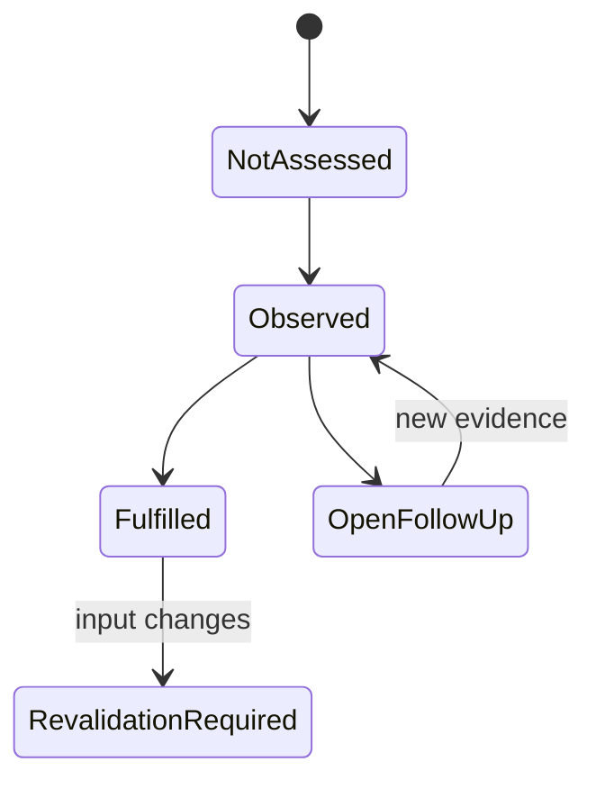

# Data Model: Evidenzobjekte / Evidence Objects

DE: Dokumentations-/Prüfobjekte, keine Datenbank und kein neuer Dienst.
JSON ist geplante Transportform für eigene Kontrollnachweise; bestehende
Assurance-Schemata und historische Formate werden nicht verändert.
EN: These are evidence/review objects, not a database or new service. Planned
JSON carries project records without altering Assurance or historical formats.

## Identitäten und Beziehungen / Identities and Relationships

| Entity | Schlüssel und Felder / Key and fields | Beziehungen / Relations |
| --- | --- | --- |
| InputBinding | intakeId, receiptId, reviewId, revision, path, rawSha256/normalizedSha256, observedAt, normalization | Ein aktueller Intake bindet geordnete Quellen; Spec-/Plan-Hash zusätzlich separat / ordered sources plus explicit feature hashes |
| HardeningFinding | gapId, clIds, historicalSource, sourceEdition, priority, currentObservation, applicability, implementation, requirementIds, owner, reviewer | GAP zu Kontroll-IDs und aktuellen Nachweisen; historische Inhalte nur verlinkt / historic gap links current observations |
| DeltaMapping | controlId, GNN, H-344-NN, AC-H-344-NN, disposition, rationale, sourceBinding, findingIds, evidenceIds | Genau 50 eindeutige IDs; jede genau eine Gruppe / 50 unique controls, one group each |
| EvidenceRecord | evidenceId, gateId, commandArgv, cwdClass, gitHead, inputHashes, payloadSha256, decisionSha256, runner, platform, architecture, imageId, sbomHash, observedAt, exitCode, outcome, writeScope, logPath, limitations | Mehrere Belege je Gate; ein Beleg darf mehrere Kontrollbezüge haben ohne Scopeausweitung / many-to-many links with fixed proof scope |
| ReviewCheckpoint | gateId, FR/SC/CL refs, applicability, implementation, reason, evidencePaths, owner, reviewer, residualRisk, nextAction, dueAt, reevaluationTrigger | Ergebnis aus Belegen und Entscheidungen, nicht aus Dateiexistenz / derived from evidence, not file existence |
| CoverageModule | path, sourceHash, language, securityBoundary, branchModel, possibleOutcomes, observedOutcomes, evidenceRefs, unmeasuredReason | Vollständiges namentliches Inventar; Tests nicht im Produktnenner / complete named product scope |
| PublicInterface | interfaceId, entrypointPaths, documentedInputs, platformVariants, criticalFlows, positiveCases, negativeCases, executedEvidence | Paare teilen fachliche ID, aber benötigen Belege je beanspruchter Variante / paired identity, distinct variant proof |
| HumanOnlyDecision | decisionId, role, question, jurisdiction, datedSource, dueAt, status, authorityEvidence, useRestriction, nextAction, trigger | Technische Prüfung schließt menschliche Entscheidung nicht / independent human authority |
| PlatformObservation | platformPath, runnerToken, nativeArchitecture, sameReviewedHead, inputHashes, imageId, commands, exits, timestamps, observedVSCodeAttach, scopeLimits | Windows und WSL2 trotz gleicher Hardware separat / distinct runtime evidence on shared hardware |
| Handoff | featureId, technicalScope, completedEvidence, unresolvedFindingIds, useRestrictions, independentReview, downstreamTarget, downstreamAuthority | Verlinkt Selbstprüfung, startet sie nicht / references but never starts next intake |

## Invarianten / Invariants

- DE: `applicability`: exakt `Applicable`, `N/A`, `Open`.
  `implementation`: exakt `Fulfilled`, `Partly Fulfilled`, `Not Fulfilled`,
  `Not Assessed`. N/A verlangt Not Assessed, Grund und Trigger.
  EN: Keep exact untranslated status enums; N/A requires Not Assessed,
  rationale and trigger.
- DE: Open/unerfüllte Punkte brauchen Owner, konkrete Folgeaktion, Frist,
  Trigger und Restrisiko. Vorliegen einer Datei ist kein Fulfilled.
  EN: Open/unfulfilled items need owner, action, due date, trigger and risk;
  an existing file alone is not fulfillment.
- DE: Eine Delta-ID hat genau eine primäre Gruppe; keine fehlende oder
  doppelte Zeile. `AlreadyCovered` ist keine Umsetzungsaussage. Derselbe
  Auditbeleg darf mehrere CLs stützen, aber nicht doppelte Schließung erzeugen.
  EN: One primary group per delta; no missing/duplicate IDs or double closure.
- DE: Striktes UTF-8, genau ein führendes BOM entfernen, CRLF/CR zu LF,
  dann SHA-256 für normalisierte Texte; Binärartefakte nur raw hashen.
  Hashart ausdrücklich benennen, kein Hash-/Versionspräfixvergleich.
  EN: Explicit normalized-text versus raw-binary hashes, exact matches only.
- DE: Jeder ausgeführte Befehl hat echte argv, Exitcode, Runner und Zeit.
  `NotRun` trägt keinen erfundenen Exit 0 und keine aktuelle Image-ID aus
  einem alten Bericht. Nur öffentliche/synthetische Ausgaben speichern.
  EN: Actual command arguments, runner/time and exit only for execution;
  never invent successful skips or leak confidential output.
- DE: Branchquote je Modul = beobachtete eindeutige Zweig-Outcomes / alle
  statisch erfassten Outcomes; Python belegt sie aus coverage.py, Shell/PS
  aus vollständigem reviewed Register und Trace. Keine gemittelte Quote,
  die ein ungeprüftes Modul verdeckt. Nenner 0: begründen, keine 100 % erfinden.
  EN: Use per-module distinct branch outcomes, with complete denominators
  and trustworthy evidence; no average hiding gaps or invented zero-denominator pass.
- DE: Interfacequote = IDs mit ausgeführten erforderlichen positiven und
  negativen Fällen / vollständiger dokumentierter Interfacekatalog. Fehlende
  Plattformvariante wird als Lücke geführt; alle geänderten Interfaces
  brauchen beide Fallarten unabhängig von der 80-%-Gesamtquote.
  EN: Interface coverage requires executed positive and negative cases in a
  complete catalog; changed interfaces always need both case types.
- DE: VEX bezieht sich auf konkrete CVE, Paketversion und Image/SBOM.
  Critical ist nicht durch VEX/Open-Ausnahme freigegeben. Open bei High ist
  keine eigenmächtige Risikoannahme; weitere Sperren bleiben wirksam.
  EN: Bind VEX to exact findings/inputs; Critical never gets a blanket override.
- DE: Nutzungs-/Freigabestatus nicht von technischer Quote, Signed-Datei,
  SBOM, CI oder Assurance-Validator ableiten. EN: Technical results do not
  establish legal, provider, accessibility or formal usage approval.

## Zustandsübergänge / State Transitions

DE: Geplant/Not Assessed → tatsächlich geprüft → Fulfilled oder konkrete
teilweise/fehlende Erfüllung. Quellen-/Code-/Imagewechsel macht betroffene
Belege erneut prüfpflichtig, nicht rückwirkend falsch. Open wird erst mit
neuer zuordenbarer Evidenz bzw. befugter menschlicher Entscheidung geändert.
Historische Zeilen bleiben erhalten, aktuelle Einordnung referenziert sie.
EN: Planned/Not Assessed becomes an observed result, fulfilled or incomplete.
Changed inputs require revalidation without rewriting history. Only new
evidence or authorized decisions resolve Open records.

DE: Diagrammzustände sind erläuternde Phasen, keine zusätzlichen JSON-
Enumwerte. Reihe bleibt Completed → Eligible → Blocked → Blocked.
EN: Diagram labels explain the workflow, not new machine enum values; keep
series lifecycle unchanged.

## Speicherung und Grenzen / Storage and Boundaries

DE: Menschenlesbare Projektbelege unter `E` gemäß Plan; Assurance-Gates nur
im datierten Kontext `A` mit bestehendem Schema 1.0:
`baseline.json`, `deltas/001-hardening-followup.json`, `closure.json`,
`image-impact.json`, `evidence-matrix.md`. Gate-Modus `development`.
`externalComparisonBoundary` bleibt der exakte installierte Vertragswert,
ausdrücklich externer Kontext, nie lokale Authority/Evidence. Versionsangaben
GSDB 3.4.4, Sammelband, zwölf CL-Dokument-IDs und Assurance-Paketversion von
Generator-/Evidence-Schema trennen. Kein neuer eigener Assurance-Schemafork.
EN: Use plan E for readable records and dated A for existing schema 1.0
Assurance gates in development mode. Preserve the exact installed external
comparison constant as nonlocal context. Separate baseline/document/package
versions from generator/schema metadata; do not fork the contract.

DE: Roh-SBOM, große Scanreports und Testspeicher ignorierte Artefakte oder
explizit zugeordnete Ablage; versionierte Markdown-Indizes binden Hashes.
Audit-Metadaten sind eine andere Datenkategorie als persönliche Agentenlogs.
Keine Datenbankinhalte, Credentials, realen Prompts oder Antworten als Test-
oder Nachweisdaten. Native Keynote-Dateien werden in diesem Feature nicht
generiert, geändert oder als Secret-Ausnahme neu gebunden.
EN: Keep generated bulk artifacts scoped/ignored with hashed readable indexes;
audit metadata and personal agent history remain different data categories.
Never use real confidential payloads as fixtures. Do not change Keynote files
or their scanner bindings.
