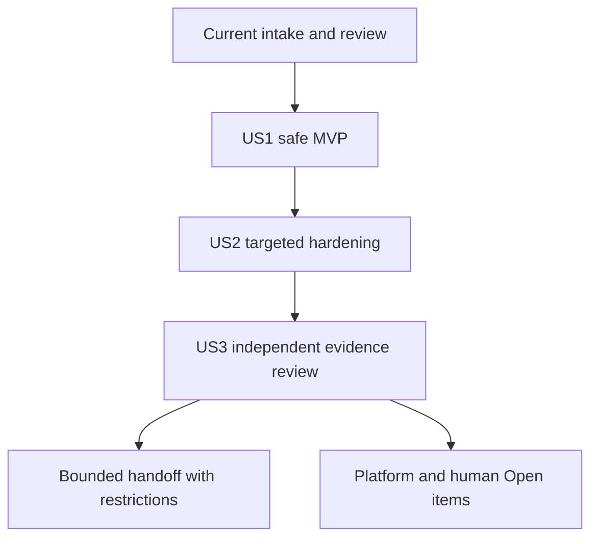

# Implementation Plan: Sandbox-Härtungsnachlauf / Sandbox Hardening Follow-Up

**Branch**: `codex/004-container-hardening-followup` | **Date**: 2026-10-26 | **Spec**: [spec.md](spec.md)
**Input**: aktueller Intake samt autorisiert erneuertem Receipt und sieben Clarifications; vormals 67 Quellen / current renewed receipt and seven clarifications; formerly 67 sources.
**Requirements Review**: 2026-10-27, base commit `88ade20`; see [review record](checklists/requirements-quality-review.md).
**Planning revision**: `5e60e21` (historischer Entwurfsstand / historical design basis); usability amendment after `596b4ca`, current Spec raw SHA-256: `b66be89f0ca28dfada82a684d1e0fc131fb044a4d5819e36d222ea50d3af4349`.

## Summary

DE: Vorhandene Schutzmaßnahmen zuerst gegen aktuelle Anforderungen prüfen,
danach nur belegte Lücken gezielt schließen. US1 ist der kleinste nutzbare
Umfang (MVP): minimale Rechte, sichere Schreibgrenzen und datenerhaltender
Stopp. US2 ergänzt Herkunft, wirksame Agentenregeln und Lieferkettenprüfung;
US3 liefert unabhängig prüfbare Evidenz und offene Entscheidungen weiter.
Die verbindlichen zehn Delta-Gruppen und 50 Kontrolländerungen bleiben
unverändert. Ein Plan ist kein Implementierungs- oder Abnahmenachweis.
EN: Assess existing safeguards first and remediate only evidenced gaps. US1
is the MVP: least privilege, safe write limits and data-preserving shutdown.
US2 adds provenance, effective agent rules and supply-chain checks; US3
delivers independently reviewable evidence and unresolved decisions. Retain
the ten groups and 50 control changes. A plan proves neither implementation
nor acceptance.

DE: Historische Grenze des ursprünglichen Planungsauftrags: ausschließlich Planungsartefakte im Feature-
Verzeichnis. Kein Test, Build, Smoke, Containerzugriff, Neustart, Agenten-
Kontextupdate, Commit oder Push. Erforderliche Quellenvalidatoren wurden nur
lesend ausgeführt. Die historische Specify-Auftragsgrenze wird nicht
umgeschrieben; dieser neue Auftrag erlaubt Planung, nicht Umsetzung.
EN: Historical boundary of the original planning request: planning artifacts only inside this feature directory.
No tests, builds, smokes, container access, restarts, agent-context updates,
commits or pushes. Required input validators ran read-only. This request adds
planning authority without rewriting the historical Specify boundary.

DE: Nachtrag 2026-10-27: Der Owner erlaubt zunächst Commit des gesichteten
Ausgangsstands, danach ausschließlich Usability-Anforderungstexte,
Lernendendokumentation, autorisierte Quellenpflege und unabhängigen Review
mit gezielter statischer Validierung. Kein weiterer Commit/Push und keine
Hardening-Implementierung, Builds oder Laufzeitaktionen.
EN: Amendment 2026-10-27: the owner authorizes one reviewed-baseline commit,
then usability requirements, learner documentation, authorized provenance
renewal and independent review with scoped static validation. No further
commit/push, hardening implementation, builds or runtime actions.

## Technical Context

| Feld / Field | Entscheidung / Decision |
| --- | --- |
| Language/Version | Python 3: Standardbibliothek für gemeinsame Logik; Image-Pin CPython 3.15.1. Bash und PowerShell 7 als bestehende Prozessgrenzen. Host-Python nicht durch Image-Python ersetzen. / Standard-library core with existing shell/PowerShell entrypoints; retain host interpreter separation. |
| Primary Dependencies | Podman, podman-compose, jq, Git, gepinnte MCR-.NET-Basis, Syft 1.55.0, vorhandener Grype-Pin aus `scripts/analyze-sbom.*`, 14 Presets, Assurance 0.1.8. Keine Upgrades allein aus diesem Plan. / Reuse pinned inputs without incidental upgrades. |
| Storage | Sechs benannte Daten-/Build-Volumes, Projekt-Bind-Mounts, Metadaten-JSONL im Audit-Mount. Kein neuer DB-Dienst; OpenCode-DB nicht öffnen/exportieren. / Persistent volumes, mounts and metadata JSONL; no new database. |
| Testing | Vorhandene Python-unittest-Suiten und native Bash-/PowerShell-Prozesse mit isolierten Fixtures; Coverage-/Grenzfallmatrix ergänzen, nichts hier ausführen. / Reuse isolated tests; add measurement rather than execute now. |
| Target Platform | macOS/Apple Silicon → linux/arm64; Windows-Host PowerShell 7/Podman-Machine und Ubuntu/WSL2-rootless → linux/amd64. Keine Rosetta-Abhängigkeit. / Separate native paths. |
| Project Type | Entwicklungs-Container plus lokale CLI-/Build-Automation, keine neue Produktanwendung. / Development container with local automation, not a new application. |
| Performance Goals | Vorhandene Prozess-/Timeoutgrenzen erhalten; keine Erhöhung zur Testberuhigung. JSON-/Argumentverarbeitung begrenzt, keine geheimen Inhalte in Reports. / Preserve bounded process budgets and redacted reporting. |
| Constraints | Default-Egress und beschreibbare Schicht bleiben; Ports nur `127.0.0.1:5100-5199`; Read-only-Variante ausdrücklich optional. Keine Anmeldung/echten Secrets für Tests. / Preserve clarified defaults and safe fixtures. |
| Scale/Scope | 15 FR, acht SC, 157 historische Kontrollbezüge als Eingabe, genau 50 Delta-Zuordnungen und 14 Presets; namentlicher Coverage-Nenner in [coverage-scope.md](coverage-scope.md). / Fixed requirement and evidence scope. |

## Constitution Check

DE: Verfassung 1.17.0; Planungsprüfung vor Phase 0 und nach Phase 1.
`Pass` unten bedeutet widerspruchsfreier Entwurf, keine bestandene technische
Kontrolle. Umsetzungsstatus aller geplanten Gates zunächst `Not Assessed`.
EN: Constitution 1.17.0, reviewed before research and after design. Planning
Pass is consistency of the design, not technical acceptance. Planned gate
implementation starts Not Assessed.

| Regel / Rule | Vorher / Before | Nachher / After | Konkretisierung / Treatment |
| --- | --- | --- | --- |
| Level-2 Registry | Pass | Pass | Zeile `container-images/absdd-image-sandbox`: Python-Helfer + Bash/PowerShell, keine C#-App. Geerbte GitLab-/Docker-Wörter nicht als Hosting-/Runtimeauftrag behandeln. / Use sandbox context, not legacy hosting names as instructions. |
| Security-first / XII | Pass | Pass | Argumentarrays, kein eval/Invoke-Expression auf Nutzereingaben; Reparse-/Symlinkgrenzen; keine Credentials oder Agentenzustände versionieren. / Structured arguments and containment. |
| MSL / XI | Pass | Pass | Python als speichersichere Kernsprache; Shell-Glue begrenzt begründen, PowerShell verwaltet; sprachbezogene Regeln in `msl-applicability.md` und `secure-coding-review.md`. / Language-specific review, not assumed safety. |
| Architecture / XIII/XVII/XVIII | Pass | Pass | Trust Boundaries, STRIDE/CIA/CAPEC, Zero Trust, arc42 §8, S-ADR und SAMM explizit geplant. / Explicit architecture/security products. |
| Standards / XIV-XIX | Pass | Pass | SSDF/CWE, Supply Chain anwendbar; ASVS-Eigenanwendung N/A; regulatorische und Cloud-Entscheidungen Open. Keine Rechtsentscheidung im Plan. / Applicability below, no legal approval. |
| Cross-platform / II | Pass | Pass | Skriptpaar, Cmdlet, man-Page, DE/EN-Hilfe und Dry-run/WhatIf gemeinsam; reale Plattformbeobachtungen getrennt. / Atomic paired interfaces and native proof. |
| A11Y / learner baseline | Pass | Pass | WCAG 2.2 AA artefaktbezogen, DE zuerst/EN danach, CEFR B2, alle vier IHK-IT-Berufe ab Jahr 1; menschlicher Review. / Bilingual novice paths and human accessibility review. |
| Agent parity | Pass | Pass | Fünf Flächen plus betroffene Vorlagen synchron; keine Constitution-Änderung ohne eigene Änderungsautorität. / Atomic maintained surfaces, no unapproved constitutional edits. |
| Evidence lifecycle | Pass | Pass | Eingaben frisch; geplant statt ausgeführt; Readiness, Erfüllung und Freigabe getrennt. Feature 003 und Reihe unverändert. / Separate status and authority. |
| Statistics | Pass | Pass | Methodik 2 unverändert, konservative manuelle Basis 80 bleibt ohne Beschleunigungsbehauptung. Spätere Lieferung prüft aktuelle Statistik separat; historische Pilotmessung nie neu rechnen. / No methodology or frozen-pilot changes. |
| Documentation Impact | Pass | Pass | Genau `UpdateRequired`; Details unten. / One explicit documentation decision. |

DE: Keine neue Verfassungsabweichung erforderlich. Agent-Kontextskript nicht
vorhanden; außerdem untersagt die Schreibgrenze jede Änderung an AGENTS und
gebundenen Quellen. Deshalb Kontextupdate bewusst nur als spätere atomare
Arbeit planen, nicht jetzt einen Ersatz-Updater erfinden.
EN: No new constitutional deviation is required. No agent-context updater is
installed, and this request forbids writes to agent/input sources. Plan that
future atomic change rather than inventing an updater now.

## Project Structure

### Documentation (this feature)

```text
specs/004-container-hardening-followup/
  spec.md                       # unverändert / unchanged
  checklists/requirements.md    # bestehender Qualitätsreview / existing review
  plan.md
  research.md
  data-model.md
  coverage-scope.md
  quickstart.md
  contracts/cli.md               # bestehende zu ändernde CLI-Grenzen / existing CLI changes
  planning-session.md            # nur dieser Planungsauftrag / this planning request
```

DE: Keine `tasks.md`, kein Run-State und kein ausgefüllter Techniknachweis in
diesem Auftrag. Ein späterer autonomer Lauf braucht eigene Autorität und
eigenen Zustand; Feature-003-Artefakte bleiben unangetastet.
EN: No tasks, run state or technical proof is produced now. Later autonomy
requires separate authority/state, never resuming Feature 003.

### Source Code (repository root)

| Fläche / Surface | Geplanter Umgang / Planned treatment |
| --- | --- |
| `Dockerfile`, `renovate.json`, `home-baseline.lock.json` | Vorhandene Pins/Checks zuerst bewerten; nur begründete Hardening-Lücken ändern. Lock nicht beiläufig aktualisieren. / Assess existing pins, no incidental upgrades. |
| `compose.yml`, `compose.home-baseline.yml`, geplantes `compose.read-only.yml` | Default-Egress/-Schreibschicht erhalten; optionale Read-only-Variante mit denselben Identitäts-/Capabilities-/Portgrenzen. / Preserve defaults; optional tested override. |
| `opencode.jsonc`, `codex/config.toml`, `codex/requirements.toml`, Agenten-Umgebung | Effektive Regeln, Updates und getrennte Zustände untersuchen; keine Anmeldung oder Providerwahl. / Review actual controls without sign-in. |
| `scripts/audit-export.*`, `scripts/compose-down-with-audit.*`, `scripts/container-entrypoint.sh` | Minimalexport erhalten; 30-Tage-Retention in Wrapper-Paar, Ein-/Austritt und Fehler prüfen. / Preserve metadata-only export; safe retention. |
| `scripts/test-ade-sandbox-hardening.*`, `scripts/lib/secure_development_hardening.py` | Wiederverwenden, Feature-004-Kontext ausdrücklich auswählbar machen; historische Defaults/Feature-003-Prüfung nicht umdeuten. / Explicit feature context, preserve legacy semantics. |
| `scripts/tests/` und [Coverage-Inventar](coverage-scope.md) | Gezielte Fixtures zuerst; bestehende echte Prozess-/Timeouttests erhalten. / Isolated tests with retained real process coverage. |
| `scripts/build-and-sbom.*`, `scripts/analyze-sbom.*` | Finales lokales Image eindeutig wählen, keine mutable latest-SBOM-Auswahl als Abnahme. / Bind exact image and SBOM, not newest-file inference. |
| `README.md`, `docs/fuer-lernende/`, `docs/betrieb/`, fünf Agentenflächen | Bestehende Leserpfade, sichere Befehle und getrennte Nachweisgrenzen fortführen. / Extend canonical reader paths and safe instructions. |

**Structure Decision**: DE: Bestehende Scripts-/Container-Struktur beibehalten,
keine API-, Web-, Datenbank- oder neue Dienstschicht. CLI-Vertrag ist nötig,
weil Audit-/Stopp- und Prüfeinstiege reale Bediengrenzen ändern; keine
erfundenen Netzwerk-Contracts. EN: Reuse existing layout; CLI contracts cover
actual interface changes, not a new service or invented external API.

## Umsetzungsschnitte / Implementation Slices

DE: Dies ist eine Reihenfolge für spätere Tasks, keine ausgeführte Aufgabenliste.
EN: These are future work slices, not executed tasks.

1. **Eingaben und Baseline / Input baseline**: vor ersten Implementierungs-
   edits Quellen/Review erneut validieren; `control-matrix.md` aus historischen
   Befunden und [Delta-Zuordnung](#delta-zuordnung--delta-mapping) aufbauen.
   Nur aktuellen Nachweis wiederverwenden; Scope, Source-Hash und Befunddatum
   müssen passen. Dann feature-lokale `gate-requirements.json` mit den unten
   stabilen Gates erzeugen, reviewen und binden. / Revalidate inputs, create
   current mapping and reviewed machine-readable gates before implementation.
2. **US1 MVP**: ein vertikaler Audit-/Stopp-Schnitt zuerst: isolierter
   Export-/Retention-/Down-Test mit Fake-Compose und künstlichem Audit-Verzeichnis,
   dann minimale Implementierung. Bestehende Exportformate und Datenvolumes
   erhalten. Erst die vollständige betroffene Aufrufkette statisch lesen,
   bevor ein erwarteter roter Test startet. / Test the whole small safety
   boundary before its fix, not a real stop of the learner service.
3. **US1 Isolation**: Rechte-/Mount-/Schreibinventar, Default-Konfiguration
   erhalten; Read-only-Override gezielt ergänzen und später mit Wegwerf-Daten
   testen. Kein globales `read_only` als stiller Standardwechsel. / Inventory
   boundaries and add only the explicit optional variant.
4. **US2 Hardening**: versionsgebundene Agenten-/Update-/Download-/Herkunfts-
   und Kryptoanalyse; sichere Fixtures und Coverage-Nenner zuerst. Nichts
   allein wegen eines historischen Open-Status neu installieren. / Evidence-led
   agent/supply-chain remediation with an honest measurement baseline.
5. **US3 Review und Übergabe / Review and handoff**: aktuelle Plattformbelege,
   finale Image-SBOM/Scanbewertung, Assurance und Human-only-Register verbinden;
   unabhängiger Reviewer prüft Gesamtpaket und offene Sperren. Kein automatischer
   Start des nächsten Intakes. / Independent review and bounded handoff only.

DE: US1 ist ohne abgeschlossene US2-/Rechts-/Cloud-Entscheidung nutzbar und
isoliert prüfbar. US2-Befunde sind einzeln bewertbar; Abschlussnachweise und
US3-Gesamthandoff hängen von den betroffenen vorherigen Ergebnissen ab.
Gemeinsame Agenten-, Evidence-, Versions-, Workflow- und Statistikdateien
werden serialisiert; kein paralleler Schreiber auf dieselbe Quelle.
EN: US1 has independent value without completed US2/legal/cloud decisions.
US2 findings can be assessed separately; final US3 handoff depends on their
applicable results. Serialize shared guidance, evidence, version, workflow
and statistics writes.

## Sicherheitsdesign / Security Design

### Audit und Retention / Audit and Retention

DE: Ein gemeinsamer kleiner Python-Helfer für die Dateiauswahl vermeidet
abweichende Datums-/Pfadregeln in den beiden Wrappern; Shell/PowerShell
behalten ihre Ein-/Ausgabegrenzen. Vorgesehener Ort:
`scripts/lib/audit_retention.py`. Kein generisches Cleanup-Framework.
Erst Export erfolgreich, dann sichere Retention, erst danach `down`.
UTC-Datum des Laufs einmal festhalten, nur reguläre direkte Tagesdateien
`YYYY-MM-DD.jsonl` im effektiv aufgelösten Audit-Mount mit Datum strikt vor
`today_utc - 30 days` entfernen. Genau 30 Tage, heutige Datei, andere Namen,
Unterverzeichnisse, Symlinks/Reparse-Points und alle Agentenvolumes erhalten.
Pfad- und Typprüfung unmittelbar vor Entfernung wiederholen; keine Symlink-
Verfolgung, Dateiinhalte oder mtime-basierte Schätzung. Stimmen Host-Auditpfad
und Container-Mount nicht sicher überein, abbrechen statt falschen Ort wählen.
EN: A small shared Python helper selects retention files consistently while
shell/PowerShell preserve their interfaces. No generic cleanup framework.
Export must succeed before retention, and retention before down. Freeze one
UTC date; remove only direct regular ISO-day JSONL files strictly older than
30 days within the resolved effective audit mount. Keep exact-boundary/today
files, other names, directories, links and all agent volumes. Recheck path/
type at deletion; never follow links, inspect contents or guess by mtime.
Abort if host/container audit locations cannot be matched safely.

DE: Vor Export eine exklusive, atomar angelegte Sperre pro kanonischem
Auditbereich erwerben. Sie bindet Run-ID und Besitz, gilt für beide Wrapper
und wird nur vom eigenen Lauf freigegeben. Ein zweiter Lauf oder eine unklare
verwaiste Sperre bricht ohne Export/Retention/Down ab; kein automatisches
Stale-Lock-Löschen. Eine manuelle Wiederaufnahme setzt die Prüfung voraus,
dass der alte Lauf beendet ist. Vorschau liest nur erforderliche Konfiguration,
erwirbt keine Sperre und öffnet keine Audit-/Agenten-Payloads.
EN: Acquire an atomically created exclusive lock per canonical audit scope
before export. Both wrappers share run/ownership semantics; only its owner
releases it. A concurrent run or ambiguous stale lock aborts without export,
retention or down. Never clear stale locks automatically; manual recovery
must establish that the prior run ended. Preview reads necessary configuration
only, never locks, writes or opens audit/agent payloads.

DE: Exporterfolg ist nicht nur Exit 0: reguläre nichtleere Tagesdatei,
aktueller Lauf und effektiver Audit-Mount müssen eindeutig zusammenpassen.
Ein leerer Sitzungsbestand kann mit erlaubten Metadaten oder explizitem
Leerbestandsnachweis ohne Sitzungsfiktion abgebildet werden; fehlende oder
leere Datei verhindert Down. Vor jeder Entfernung Typ, Pfad und beobachtete
Datei-/Verzeichnisidentität prüfen, Links/Reparse-Points nicht verfolgen.
Unsichere native Umsetzung bleibt Gate Open, nicht als race-sicher behaupten.
Eine Wrapper-Sperre koordiniert nur kooperierende Wrapper; ein fremder Writer
darf daraus keine implizite Vertrauensstellung erhalten.
EN: Export success requires a regular nonempty day file bound to the current
run and effective mount, not just exit 0. Empty session inventory may use
allowed metadata or explicit no-data evidence without invented sessions.
Recheck path/type and file/directory identity; never follow links/reparse
points. Unproven native safety remains Open rather than claimed race-safe.
A wrapper lock only coordinates cooperating wrappers, not untrusted writers.

DE: Ungültiger Export, unklare Pfade oder Löschfehler verhindern `down`,
werden redigiert gemeldet und setzen keinen erfolgreichen Stoppstatus.
Sicherheitsbedingtes strengeres Verhalten wird in Hilfe/Regressionsfällen
erklärt. Dry-run/WhatIf exportiert, löscht und stoppt nichts. Eine spätere
Datenschutzentscheidung kann die lokale 30-Tage-Regel ändern; diese ist keine
behauptete gesetzliche Frist. Sitzungsfelder für OpenCode 2 bleiben ein
separates Open: kein SQL, keine DB-/WAL-/SHM-Inhalte, keine Prompt-/Antworttexte.
EN: Invalid export, unresolved paths or deletion error fail closed before
down, with redacted diagnostics and no success claim. Explain this stricter
safe behavior. Dry-run/WhatIf exports, deletes and stops nothing. The 30-day
setting is local policy, not statutory retention; a later responsible decision
may supersede it. OpenCode 2 session evidence remains separate and never
uses database/WAL/SHM, prompt or response exports.

DE: Bei Teilfehlern gibt es keinen atomaren Lösch-Rollback: schon entfernte
abgelaufene Metadaten nicht wiederherstellen oder als erhalten behaupten.
Redigierten Phasen-/Anzahlstatus melden, noch vorhandene Daten erhalten,
Down unterlassen und eigene Sperre geordnet freigeben. Wiederanlauf mit neuer
Sperre und neuem Export ist für verbleibende Dateien idempotent. Erfolgskriterien
„0 alte Dateien“ gelten für den kontrollierten erfolgreichen Lauf, nicht für
einen Fehlerabbruch oder unkooperierende parallele Neuschreibvorgänge.
EN: Deletion is not an atomic rollback transaction. Report already removed
expired metadata honestly, preserve remaining data, skip down and release
only the owned lock. Retrying acquires a new lock and reexports before
idempotent selection of remaining files. Zero-old-files describes successful
controlled completion, not failed or externally modified concurrent runs.

### Read-only-Variante / Read-Only Variant

DE: `compose.read-only.yml` als expliziter Override, nicht automatisch geladen.
Er enthält `read_only: true`, begründete `tmpfs`-Orte und unveränderte
Non-root-/Port-/Capabilities-Grenzen. Beschreibbare Home-/Cacheorte erst
inventarisieren; im Prüfkandidaten nur temporäre, leere Volumes/Mounts, keine
persönlichen Zustände. Jede freigegebene Sprach-/Dokumentations-/Editorfunktion
benötigt Beobachtung; globale Paketinstallation darf als nicht unterstützter
Ablauf dokumentiert bleiben. Schreibbare Host-Mounts bleiben schreibbar:
Read-only ist kein zusätzlicher Host-Dateischutz. Keine Behauptung vollständiger
Unveränderlichkeit oder automatischer Egress-Sperre.
EN: Use an explicit optional override, never a new default. Add justified tmpfs
paths after inventory while retaining non-root, port and capability controls.
Use disposable state only. Observe supported language/docs/editor workflows;
global package installs may remain unsupported. Writable host mounts remain
writable: rootfs read-only is not host-file protection or egress restriction.

### Agenten und Lieferkette / Agents and Supply Chain

DE: OpenCode, Codex, Claude, Gemini, Copilot und Antigravity getrennt erfassen.
Unterstützte Auto-Update-Schalter anhand der exakt installierten Version
ermitteln, standardmäßig abschalten, mit kontrolliertem Fake-Updater prüfen;
unbekannte Schalter nicht aus anderen Versionen kopieren. Nicht abschaltbare
Updates bleiben Open mit Nutzungsgrenze. Sicherheitsprüfungen decken globale,
Agenten-, Projekt- und Subagent-Overrides separat ab. Synthetische
Ausschluss-/Loop-Szenarien ohne Providerzugriff; unbeobachtete echte
Modellschleifen bleiben `UPD-V2-LOOP`, keine Modellproben als stiller Fallback.
EN: Inventory all six installed agent clients separately. Derive supported
update switches from exact versions, disable and exercise with fake updaters;
do not guess cross-version flags. Record non-disableable updates and usage
limits. Separate global, agent, project and subagent override review. Use
synthetic tests without providers; missing real model-loop evidence stays Open.

DE: Native Architektur, gepinnte Downloads samt Prüfsummen, offizieller
Maven-Fallback und unveränderte Renovate-Erfassung zuerst bewerten. Finale
SBOM an unveränderliche Image-ID und Eingabehashes binden. Grype-Pin und
Vulnerability-DB-Version/Datum festhalten. Critical blockiert immer.
Fixable High benötigt Fix, begründetes VEX `not_affected` oder vollständig
offenen Owner-/Follow-up-/Trigger-Eintrag nach Clarification; dieser Eintrag
ist keine menschliche Risikoakzeptanz und hebt andere Nutzungssperren nicht
auf. High ohne Fix bleibt dokumentiertes Restrisiko. Signatur/SLSA-Level
nicht aus einem Scan ableiten; keine Schlüssel erzeugen. Lizenzfälle und
Registry-Veröffentlichung bleiben getrennte Entscheidungen.
EN: First assess native pins, verified downloads, official fallback and
Renovate capture. Bind final SBOM to immutable image and build inputs, and
record scanner/database identity. Critical always blocks. Fixable High needs
a fix, justified VEX not_affected or the clarified complete Open record;
that record is not human risk acceptance or cancellation of other restrictions.
Unfixable High remains residual risk. Scans prove no signature/SLSA level;
generate no keys and keep rights/distribution decisions separate.

## Delta-Zuordnung / Delta Mapping

DE: Die folgende vollständige Partition übernimmt die bestehenden
Dispositions unverändert. Jede Kontroll-ID erscheint einmal. Je GNN gelten
unverändert `H-344-NN` und `AC-H-344-NN`; erwartete Evidenz siehe Gate-Tabelle.
`AlreadyCovered` ist Anforderungsabdeckung, nicht bestandene Umsetzung.
EN: This complete partition preserves existing dispositions. Each control
occurs once; each group retains its matching intake requirement/criterion.
AlreadyCovered describes requirement coverage, not a technical pass.

| Gruppe / Group | Delta-IDs | Disposition | FR |
| --- | --- | --- | --- |
| G01 | CL-01-01, CL-01-10, CL-01-11 | UpdateRequired | FR-001, FR-014 |
| G02 | CL-08-12, CL-08-10, CL-08-13, CL-08-02 | UpdateRequired | FR-002, FR-003 |
| G02 | CL-02-02 | AlreadyCovered | FR-002 |
| G02 | CL-08-03 | N/A: keine eigene Login-Implementierung; bei Aufnahme neu prüfen / no first-party login; reassess on addition | FR-003, FR-005 |
| G03 | CL-09-01, CL-09-11, CL-12-05 | UpdateRequired | FR-005 |
| G04 | CL-09-06, CL-09-05, CL-01-03, CL-05-13, CL-05-11 | UpdateRequired | FR-004, FR-007 |
| G05 | CL-09-13, CL-10-12, CL-11-06, CL-11-07, CL-11-11, CL-11-12, CL-11-08 | UpdateRequired | FR-006 |
| G06 | CL-07-03, CL-07-12, CL-09-16, CL-07-06, CL-07-01, CL-07-07, CL-07-11, CL-01-12, CL-06-07, CL-06-09, CL-07-02, CL-07-10, CL-07-04, CL-07-05, CL-07-08, CL-07-09 | UpdateRequired | FR-008 |
| G07 | CL-08-06, CL-03-10, CL-03-07, CL-03-14 | UpdateRequired | FR-009 |
| G07 | CL-03-02 | N/A: keine eigene Krypto-/Schlüsselerzeugung; bei Aufnahme neu prüfen / no first-party cryptography; reassess on addition | FR-009 |
| G08 | CL-12-12 | UpdateRequired | FR-010 |
| G09 | CL-02-13, CL-02-12 | UpdateRequired | FR-011 |
| G10 | CL-01-08, CL-09-12 | UpdateRequired | FR-012 |

DE: Historische 157 GAP-Einträge nicht pauschal schließen: im künftigen
`control-matrix.md` je GAP-ID/CL-ID historische Quelle, aktuelle Beobachtung,
Priorität, Maßnahme oder begründete Nichtanwendbarkeit/Open, Nachweis und
Human-only-Rolle führen. Keine neue Voll-Selbstprüfung aller CLs vorwegnehmen;
dies ist die Befund-Disposition zur Härtung, der nächste Intake prüft unabhängig.
EN: Never blanket-close 157 historic gaps. Record original source, current
observation, priority, action/N/A/Open, evidence and human role per gap/control
in the future matrix. This is hardening disposition, not the next full
independent checklist self-review.

## Anforderungsabdeckung / Requirements Coverage

| FR | Umsetzungsschnitt / Slice | Validierung und Evidenz / Validation and evidence | SC |
| --- | --- | --- | --- |
| FR-001 | Baseline/US2/US3 | 50er-Partition und historische GAP-Bezüge, G004-01 | SC-001 |
| FR-002 | US1 | Default-/Read-only-Grenztests und Mountinventar, G004-02/03 | SC-002 |
| FR-003 | US1/US2 | Vollständiger Nenner, positive/negative Fälle, G004-04 | SC-002/003 |
| FR-004 | US2 | Download-/Fallback-/Hash-Fixtures und Herkunft, G004-05 | SC-004 |
| FR-005 | US1/US2 | Versionen, Updates, Overrides, synthetische Ausschlüsse, G004-06 | SC-004 |
| FR-006 | US1/US3 | Export/Retention/Down-Fakes, Session-Grenze, G004-07 | SC-002/008 |
| FR-007 | US2/US3 | Finale SBOM und Scan-/Rechte-Disposition, G004-08 | SC-004 |
| FR-008 | US3 | Rollen-/Anwendbarkeitsregister und Human-Review, G004-09 | SC-005/008 |
| FR-009 | US2/US3 | TLS-/Krypto-/Migrationsinventar, G004-10 | SC-004 |
| FR-010 | US2/US3 | 14er-Profil, Metadaten-Mutationsfälle, G004-11 | SC-005 |
| FR-011 | US3 | Cloud-Screening und menschliche Follow-ups, G004-12 | SC-005/008 |
| FR-012 | US1/US3 | Bilinguale Leserpfade und Human-A11Y, G004-13/14 | SC-006 |
| FR-013 | US2/US3 | Drei getrennte Plattformpfade, G004-15/16/17 | SC-007 |
| FR-014 | US3 | getrennte Statusfelder, Owner/Reviewer/Frist, G004-01/18 | SC-001/005/008 |
| FR-015 | US3 | unabhängige Handoff-Prüfung und Sperren, G004-18 | SC-008 |

## Governance- und Abnahme-Gates / Governance and Acceptance Gates

DE: `E` steht für das in der Spec verlangte Markdown-Verzeichnis
`docs/security/secure-development/004-container-hardening-followup/`.
`A` ist der separat datierte Assurance-Kontext
`docs/security/secure-development/2026-10-26-004-container-hardening-followup/`.
Nur A enthält Assurance-Gate-JSON; E verweist darauf. Diese Trennung erhält
Spec-Pfade und den obligatorischen datierten Assurance-Vertrag ohne
historische Evidence umzuschreiben. Kein Verzeichnis wird jetzt erzeugt.
EN: E is the specified readable evidence directory; A is the single dated
Assurance context. Keep gate JSON in A and link from E, preserving both the
spec paths and required Assurance layout without rewriting history. Neither
directory is created now.

DE: Das Datum im geplanten A-Verzeichnis bezeichnet den reservierten
Planungskontext, keine durchgeführte Prüfung vom 26. Oktober. Tatsächliche
createdAt-/reviewedAt-/Ausführungszeiten müssen beim späteren Lauf wahrheitsgemäß
erfasst werden; keine Rückdatierung und kein zweiter datierter Kontext
derselben ID zur Umgehung eines ungültigen Nachweises.
EN: The planned A date reserves a context; it claims no executed October 26
check. Record actual creation/review/execution times later without backdating
or a duplicate same-ID context to bypass invalid evidence.

DE: Standardowner Maintainer, Standardreviewer unabhängiger Security Review;
abweichende Rollen unten. Jeder Gate-Datensatz führt FR/SC, Kontroll-IDs,
exakte Befehlsliste, Revision, Payload-/Entscheidungshash, Schreibscope,
Exitcode, Zeit, Runner/Architektur und Restrisiko. Fehlende Plattform ist Open/
Blocked, kein N/A. Befehlsgruppen sind im [Quickstart](quickstart.md) definiert.
EN: Default owner is Maintainer, default reviewer independent Security Review.
Each gate binds requirements, controls, exact commands, revision, hashes,
write scope, exits, time, runner/architecture and residual risk. Missing
platforms are Open/Blocked, not N/A. Quickstart defines command groups.

DE: Versions-/Prioritätsbasis ist die vorhandene Datei
`scripts/config/spec-kit-project-statistics-governance-presets.json`, kein
neues Installationsprofil. Die später geprüfte Ist-Installation muss dazu
passen; hier wird kein Installations- oder Funktionsnachweis behauptet.
EN: The existing fourteen-preset registry supplies exact versions/priorities,
not a new installation profile. Later validate actual installed payloads;
this plan claims neither installation nor successful execution.

| Preset | Version | Priority |
| --- | --- | --- |
| security-governance | 0.7.4 | 10 |
| secure-development-assurance-governance | 0.1.8 | 15 |
| architecture-governance | 0.6.5 | 20 |
| isaqb-architecture-governance | 0.2.5 | 30 |
| a11y-governance | 0.4.6 | 40 |
| cross-platform-governance | 0.2.5 | 50 |
| agent-parity-governance | 0.4.5 | 60 |
| model-routing-governance | 0.1.7 | 61 |
| intake-authoring-governance | 0.3.10 | 64 |
| intake-review-governance | 0.2.7 | 65 |
| intake-sequencing-governance | 0.2.11 | 66 |
| autonomous-run-governance | 0.4.7 | 70 |
| parallel-autonomous-run-governance | 0.2.9 | 80 |
| project-statistics-governance | 0.1.3 | 90 |

| Gate | Applicability | Scope/Befehlsgruppe / Scope/commands | Markdown-Evidenz / Evidence | Trigger / Owner-Abweichung |
| --- | --- | --- | --- | --- |
| G004-01 | Applicable | Quellen, GAP-/Delta-Zuordnung; Q1 | E/control-matrix.md | Quellen-/Baselinewechsel / source change |
| G004-02 | Applicable | Rechte, Mounts, Default-Egress; Q3/Q5 | E/platform-parity.md, E/threat-model.md | Compose-/Mountänderung / changed mounts |
| G004-03 | Applicable | optionale Read-only-Variante; Q3/Q5 | E/platform-parity.md | neue Schreiborte / write paths |
| G004-04 | Applicable | Python-Branches + nachvollziehbare Shell-/PS-Zweigbelege; Q2/Q4 | E/secure-coding-review.md, E/msl-applicability.md | Quell-/Nenneränderung / denominator drift |
| G004-05 | Applicable | Pin-/Downloadintegrität; Q2 | E/dependency-audit.md | Abhängigkeits-/Quellenwechsel / dependency change |
| G004-06 | Applicable | sechs Agenten, Updates/Overrides; Q2/Q5 | E/agent-security-review.md | CLI-/Konfigwechsel / agent change |
| G004-07 | Applicable | Audit/30-Tage-Retention/Fail-closed-Stopp; Q2 | E/audit-retention-review.md, E/gdpr-applicability.md | Datenfluss-/Fristwechsel / privacy role co-review |
| G004-08 | Applicable | SBOM, CVE-Schwelle, VEX/SLSA/Lizenzen; Q6 | E/supply-chain-evidence.md | finales Image/Scan-/Lizenzwechsel / rights review |
| G004-09 | Open | Produkt/Werkzeug/Organisation; Dokumentenreview | E/regulatory-applicability.md und fünf Rechtsdetaildateien / legal detail records | O-344-HUMAN; Owner + qualifizierter Review vor betroffener Nutzung / before affected use |
| G004-10 | Applicable | vorhandene Kryptografie und Konflikte; Review | E/crypto-tls-inventory.md | Krypto-/TLS-Profilwechsel / profile change |
| G004-11 | Applicable | 14 Presets + Assurance positive/negative; Q1/Q2/Q7 | E/preset-assurance-review.md, A/evidence-matrix.md | Quartal/Anlass + 3. Oktober / assigned Maintainer |
| G004-12 | Open | C3A/C5-/Provider-/Registry-Screening | E/cloud-autonomy-applicability.md, E/cloud-compliance-assurance.md | O-344-CLOUD; Owner + Architecture Review vor Erweiterung / before extension |
| G004-13 | Applicable | fünf Agentenflächen, Sprache/Lesepfade; Q2/Q8 | E/agent-parity-review.md, E/documentation-review.md | gemeinsame Regel-/Textänderung / shared guidance |
| G004-14 | Applicable | manueller A11Y-/Erstnutzungsreview | docs/accessibility/004-container-hardening-followup.md, E/learner-usability-review.md | DOC-A11Y; Learning/A11Y Review vor Konformitäts-/Erstnutzungsclaim / before conformance or independent-first-use claim |
| G004-15 | Applicable | echter macOS-Host/ARM64-Kandidat; Q5 | E/platform-macos.md | aktuelles Image/Head / Platform Review |
| G004-16 | Applicable | Windows-Host-PowerShell7-Podman; Q5 | E/platform-windows.md | UPD-AMD64 vor AMD64-Nutzung / Platform Review |
| G004-17 | Applicable | Ubuntu-WSL2-Bash-rootless-Podman; Q5 | E/platform-wsl2.md | UPD-AMD64 vor AMD64-Nutzung / Platform Review |
| G004-18 | Applicable | unabhängige Gesamtübergabe, dokumentierte Sperren | E/handoff.md | Änderungen nach Review / independent reviewer |

DE: Zusätzliche Standardentscheidungen: NIST SSDF, CWE Top 25, OWASP
Cheat Sheets/Proactive Controls, SBOM, Dependency Audit und Scorecard
`Applicable`. STRIDE/CIA/CAPEC und Zero Trust `Applicable` für Trust Boundaries;
SAMM als begrenzte Ist-/Zielbewertung, nicht behauptete Organisationsreife.
Neue eigene Web-/API-/Auth-Dienste/ASVS `N/A`, `E/asvs-verification.md`,
Begründung keine Eigenanwendung, Trigger Aufnahme eines Dienstes. Eigene
Modell-/Trainings-AI-SBOM `N/A` in E/supply-chain-evidence.md; bei eingebettetem
Modell/Dienst alle sieben G7/BSI-Cluster bewerten. Clientinstallation allein
beweist das nicht; Providertransparenz bleibt separat. SLSA/Signaturen/VEX
haben anwendbare Prüfung, unbelegte Erfüllung bleibt Open. Dependency-Track-
Ingestion ist ohne vorhandenen Dienst Open mit Maintainer, Follow-up vor
Weitergabe prüfen, Trigger neuer zentraler CVE-Dienst; keinen Dienst installieren.
EN: Apply the named secure-development/supply-chain standards and scoped
threat/Zero Trust review, with bounded SAMM. New first-party ASVS services
are N/A until added. Own-model AI-SBOM is N/A until a model/service becomes
part of operation, then assess all seven clusters. Supplier transparency stays
separate. Applicable signature/SLSA/VEX assessment does not imply fulfillment.
Absent Dependency Track ingestion is an owned follow-up, not permission to
install a service or substitute a static audit for ongoing monitoring.

DE: DSGVO, KI-VO, CRA, NIS2/BSIG und DORA erhalten pro Produkt/Werkzeugbetrieb/
Organisation Land, Rolle, datierte Primärquelle, Pflichtart, Anwendungsdatum
und Human-Reviewer. O-344-HUMAN/CLOUD behalten Grund, Owner, Follow-up, Frist
vor betroffener Nutzung/Weitergabe und Trigger. Privacy by Design: Zweck,
Datenkategorien, Empfänger/Region, Minimierung, Aufbewahrung/Löschung und
Betroffenenrechte in Datenflüssen. Resilienz-/Exit-/Konzentrationsrisiko nur
bei einschlägiger Lieferantenrolle konkretisieren. C3A: bei Anwendbarkeit
alle 30 Gruppen mit genauen C-/AC-IDs und Variante, SI nur Erläuterung.
C5 Typ 1 ist Zeitpunkt, Typ 2 benötigt Zeitraum/Wirksamkeit; Unknown ist Open,
kein Ersatz für C3A oder regulatorische Freigabe.
EN: Record role/country, dated primary source, direct versus contractual duty,
application date and human reviewer for each product/tool/organisation scope.
Keep owned due dates before affected use/distribution. Map privacy purposes,
categories, recipients/regions, minimization, retention/deletion and rights.
Plan resilience/exit/concentration assessment for relevant supplier roles.
Applicable C3A retains all 30 groups and exact C/AC/variant evidence; SI is
guidance. C5 Type 1 is point-in-time; Type 2 requires period/effectiveness.
Unknown stays Open, not a substitute for C3A or regulatory approval.

## Dokumentation und Parität / Documentation and Parity

### Sicher bedienbarer Lernpfad / Usable Secure Learning Path

DE: FR-012/SC-006 werden in den bestehenden Pfaden umgesetzt: `erste-schritte.md`
beschränkt den Einstieg auf eine gewählte Aufgabe (Python als ausführbares
Beispiel), `alltag.md` deckt Speichern/Stoppen/Wiederöffnen ab und
`troubleshooting.md` trennt Selbsthilfe von betreuter Wiederherstellung.
Die vollständige Werkzeug-/Governanceabnahme bleibt unter `docs/betrieb/`.
Keine Rechteerweiterung, kein automatisches Entsperren, kein Machine-Reset und
kein Umgehen des Audit-Exports als Komfortfunktion. Fehlermeldungen der späteren
Wrapper-Implementierung erklären Ursache, Phase, tatsächlich veränderte Daten,
sicheren nächsten Schritt und zuständige Hilfe; keine unbelegte Zusicherung
„alles unverändert“ nach möglicher Teil-Retention.
EN: Extend existing first-success, daily and recovery guides, with one selected
task and Python as a runnable example. Keep full tool/governance acceptance in
operations guidance. Never add privilege expansion, automatic lock removal,
machine reset or audit bypass for convenience. Future wrapper messages explain
cause, phase, actual data changes, safe next action and assistance; never claim
all data is unchanged after possible partial retention.

DE: Learning/A11Y Review plant einen freiwilligen, betreuten Pilot ohne echte
Agenten-/Anmeldedaten: öffnen, Aufgabe wählen, synthetische Datei im eigenen
Projekt-Mount speichern, auditgesichert stoppen und erneut öffnen; Datei
wiederfinden. Danach einen synthetischen Exportfehler in isolierten Fixtures
zeigen und anhand der Fehlerhilfe korrekt eskalieren/wiederaufnehmen.
G004-14 erhält `E/learner-usability-review.md` zusätzlich zum A11Y-Beleg.
Pro Schritt Ergebnis, Hilfebedarf, Fehlversuche, Verständnis und Schutzintegrität
festhalten, keine personenbezogenen Rohprotokolle. Normalablauf ohne Admin,
Datenverlust oder Bypass; Fehlerfall braucht keine selbständige Admin-Reparatur.
Alle vier Berufe mit vier Fachinformatik-Fachrichtungen im Rekrutierungs-/
Abdeckungsplan nennen, fehlende Beobachtungen nicht verallgemeinern. Nicht
durchgeführt: Open, Owner Learning/A11Y Review, Follow-up betreuten Pilot
organisieren, Trigger vor Behauptung selbständiger Erstnutzung. Sicherheits-,
WCAG- und Plattformnachweise bleiben getrennt. Dieser Auftrag plant den Pilot,
führt ihn und neue Laufzeittests nicht aus.
EN: Learning/A11Y Review plans a voluntary supervised pilot using synthetic
files and no real agent credentials: open, select one task, save in a project
mount, audit shutdown, reopen and find the file. Then demonstrate an isolated
synthetic export failure and safe escalation/recovery using the guide.
Add `E/learner-usability-review.md` to G004-14 alongside accessibility evidence.
Record outcomes, assistance, mistakes, comprehension and safeguard integrity
without personal raw logs. Ordinary operation requires no admin, data loss or
bypass; error recovery need not be independent admin repair. Plan audience
coverage for all occupations/tracks and keep unobserved cases explicit. Pilot
not run: Open, Learning/A11Y Review owner, organize pilot, reevaluate before
claiming independent first use. Keep security/WCAG/platform evidence separate.

DE: Documentation Impact = `UpdateRequired`. Owner Maintainer, Sprach- und
A11Y-Partner Learning/A11Y Review. Klassen: Lernanleitung, Betriebsanleitung,
CLI-Hilfe und technische Governance-Evidenz. Kanonisch bleiben Intake/Spec
für Anforderungen und E für aktuelle Umsetzungsnachweise; README und bestehende
Indizes verlinken dorthin. Navigation: sichere Stopp-/Retention-/Read-only-
Erklärung in bestehenden Leserpfaden, keine zweite Lernreihe. Befehle erklären
Host/Ubuntu-WSL2/Container, Shell, Voraussetzungen, Ergebnis und Fehlerhilfe.
DE zuerst und gleichwertiges EN, normale deutsche Orthografie, CEFR B2.
EN: Documentation Impact is UpdateRequired, owned by Maintainer with Learning/
A11Y partnership. Keep requirements and implementation evidence distinct,
extend canonical indexes and reader paths rather than another learning series.
Explain each command's location, shell, prerequisites, result and recovery.
Use equivalent German-first/English prose at about CEFR B2.

DE: Zielgruppenbezüge im gemeinsamen Leserpfad, keine neuen Curricula oder
Anwendungen allein zum Erfüllen der Tabelle. Je Gruppe mindestens einen
relevanten bestehenden Aufgaben-/Bedienbezug und passende Voraussetzungen
redaktionell zuordnen; tatsächliche Lernenden-/A11Y-Abnahme bleibt separat.
EN: Map at least one relevant existing task/usage path and prerequisites per
audience in shared guides, not new curricula or applications merely to fill
this table. Actual learner/accessibility acceptance remains separate.

| Zielgruppe / Audience | Zuordnungsbezug / Usage focus |
| --- | --- |
| Fachinformatik Anwendungsentwicklung / application development | Projekt-, Toolchain- und Build-/Prüfablauf / project and build/check workflow |
| Fachinformatik Systemintegration / systems integration | Rootless, Mounts, Rechte und Betrieb / isolation, rights and operation |
| Fachinformatik Daten- und Prozessanalyse / data and process analysis | Synthetische Daten, Metadatenkategorien und datensparsame Analyse / synthetic data and minimal metadata analysis |
| Fachinformatik Digitale Vernetzung / digital networking | Datenflüsse, Netzwerkgrenzen, Egress und lokale Ports / flows and network boundaries |
| IT-System-Elektronik / IT systems electronics | Host-/VM-/Container-Abgrenzung und Diagnose / platform layers and diagnostics |
| IT-System-Management / IT systems management | Werkzeugauswahl, Lizenz-/Providergrenzen und Betriebsverantwortung / tools, rights and operational roles |
| Digitalisierungsmanagement / digitalization management | Prozess-/Datenflussbeschreibung und menschliche Entscheidungswege / processes, flows and decision paths |

DE: Die vier Fachinformatik-Fachrichtungen bilden zusammen einen der vier
IT-Berufe; die Tabelle macht daraus nicht sieben verschiedene Berufsabschlüsse.
EN: The four IT specialist tracks belong to one of four occupations, not
seven distinct qualifications.

DE: WCAG-Zuordnung aus Spec CR-002/003: Struktur/Tabellen 1.3.1, nicht nur
Farbe 1.4.1, Kontrast/Reflow 1.4.3/1.4.10 beim Rendering, Tastatur 2.1.1,
Überschriften 2.4.6, Sprache 3.1.1/3.1.2, Fehler-/Eingabehilfe 3.3.1/3.3.2.
Textmodus, Screenreader und soweit verfügbar Braille prüfen; fehlende
menschliche Geräteprüfung offen dokumentieren. PDF-Funktion ist keine
PDF-Barrierefreiheit. Didaktische Kommentare zu neuer nichttrivialer Logik
und vorhandene Kommentare auf Korrektheit reviewen.
EN: Map the listed criteria to artifacts and real rendered/terminal use;
include text, keyboard, screen-reader and available Braille review. Missing
human/device evidence stays explicit. PDF generation proves no accessibility.
Review didactic and changed-code comments for accuracy.

DE: Gemeinsame Regeln atomar in `AGENTS.md`, `CLAUDE.md`, `GEMINI.md`,
`.github/copilot-instructions.md`, `.github/agents/copilot-instructions.md`;
betroffene `scripts/templates/`-/`.specify/templates/`-Ableitungen mitführen.
Keine neue gemeinsame Grundregel an der Constitution vorbei: wäre eine
Änderung nötig, erst Ownerentscheidung, dann Constitution/Vorlagen/Flächen
gemeinsam; vorher blockieren. Jede gebundene Quellenänderung vor späterer
Fortsetzung autorisiert archivieren/rebinden und unabhängig vollständig
reviewen, niemals nur Hashes zum Bestehen erneuern. Der Usability-Nachtrag
führt diese Quellenpflege separat vom ursprünglichen Planungsauftrag aus.
EN: Update all five maintained surfaces and affected templates atomically.
New constitutional principles require separate authority and synchronized
sources. Before later continuation after bound-source changes, perform an
authorized archive/rebind and full independent review, not hash-only fixes.
The usability amendment performs separately authorized provenance renewal;
it does not retrospectively change the original planning authority.

DE: Distribution: Repository-Dokumentation und lokaler Selbstbau, keine
Registry-Publikation. Home-sync `N/A`, keine Level-0-/Runtimeänderung; Trigger
anderer Synchronisationsscope. Beleg E/documentation-review.md, erneute
Prüfung bei Bedienungs-, Plattform-, Datenfluss- oder Quellenwechsel.
Template bleibt vorbereitet, nicht aktiviert; LIC-01/weitere LIC-02 offen.
EN: Distribute source documentation/local self-build, not registry images.
Home sync is N/A until synchronization scope changes. Record documentation
review and reevaluate on changed behavior, platforms, flows or sources.
Template remains prepared, not enabled; unrelated licence scopes stay Open.

## Abschlussgrenzen und spätere Lieferung / Closure and Later Delivery

DE: Nach geklärter Spec darf ein begrenzter Feature-Handoff mit echtem
macOS/ARM64-Beleg erfolgen, während fehlende Windows-/WSL2-Belege explizit
Open/Blocked bleiben; AMD64-Nutzung bleibt gesperrt. Das ist keine allgemeine
Plattform- oder Sandboxabnahme. Fehlende Coverage ist keine erfüllte Quote.
Critical-CVEs sperren immer. Assurance `Ready` ist bei offenen Pflichtpunkten
unzulässig; `ReadyWithAcceptedRisks` braucht echte autorisierte Risikoannahme.
Technische Übergabe, Human-only-Entscheidungen und Folge-Intake-Start werden
getrennt berichtet. Reihe wird durch diesen Plan nicht verändert.
EN: Clarified scope permits bounded feature handoff with real macOS/ARM64
proof and explicit Windows/WSL2 gaps, keeping AMD64 use restricted. This is
not broad acceptance. Missing coverage is no fulfilled threshold. Critical
always blocks; Assurance Ready cannot hide mandatory Open items, and
accepted-risk status needs actual human authority. Separate technical handoff,
human decisions and downstream starts; planning changes no series status.

DE: Vor späterem Commit exakte Liefermenge und Staging prüfen; keine
historischen Logs oder SBOM-Artefakte automatisch aufnehmen. Falls später
Remote-Lieferung autorisiert wird: genaue Head-Revision, neue technische
Checks und sämtliche Reviewthreads prüfen; frühere grüne CI gilt nicht.
Keine Remote-Aufgabe ist jetzt autorisiert. Neue Autonomie nur auf separaten
Auftrag mit eigenem State/Schema und expliziter Stop-/Resume-/Driftgrenze.
Kein selbstreferenzieller Closeout-Pfad nötig in diesem Planungsauftrag.
EN: Later commits need exact delivery-set/staging validation. Do not silently
stage historical logs/generated SBOMs. Later authorized remote delivery needs
exact-head checks and review-thread inspection, never previous green CI.
There is no current remote task or autonomous authority. A later autonomous
run needs its own valid state and explicit recovery boundaries.

## Complexity Tracking

DE: Keine neue Verfassungsverletzung. Ein schmaler Retention-Helfer und ein
optionaler Compose-Override sind kleiner als ein Cleanup-Dienst oder neue
Sandbox-Plattform. Testmessung bleibt ehrlich Open, wenn ein Sprachwerkzeug
keine Branch-Werte liefert; keine semantische Abschwächung auf Line-Coverage.
EN: No new constitutional violation. A small retention helper and optional
override avoid a new cleanup service/platform. Measurement gaps stay Open
rather than silently reducing branch coverage to line coverage.

## Mermaid und Spec-Kit-Abschlussbericht / Mermaid and Completion Report

DE: Textfolge: frische Eingaben → isolierter US1-Sicherheitsnachweis →
gezielte US2-Befundbearbeitung → US3-Review und Übergabe. Fehlende Plattform-
oder Human-Belege bleiben daneben offen, Folge-Intakes bleiben gesperrt bis
deren eigene Startbedingungen erfüllt sind. Ein vollständiger späterer Lauf
schreibt `completion-report.md`; Plan allein tut dies nicht.
EN: Current inputs precede the US1 safety slice, targeted US2 remediation and
US3 review/handoff. Platform/human gaps retain their restrictions; downstream
work needs its own start conditions. Only a later completed feature run
produces the full completion report.


