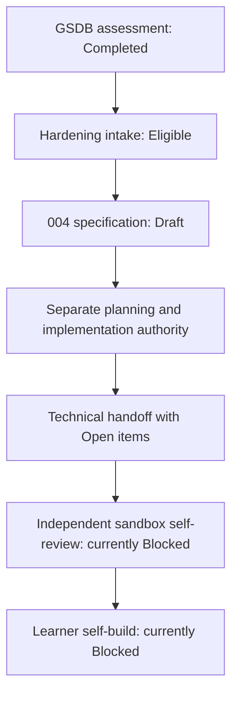

# Feature Specification: Sandbox-Haertungsnachlauf / Sandbox Hardening Follow-Up

**Feature Branch**: `codex/004-container-hardening-followup`
**Created**: 2026-10-25
**Status**: Draft
**Input**: `Lastenheft_Secure-Development-Container-Hardening.md` mit aktuellen Quellenbindungen / with current source bindings.

DE: Eine Sandbox ist eine begrenzte Entwicklungsumgebung. Dieser Nachlauf
ueberfuehrt die geprueften Anforderungen in eine neue Spezifikation, nicht in
eine bereits ausgefuehrte Haertung. Zielgruppe sind Lernende ab dem ersten
Ausbildungsjahr aller vier IHK-IT-Berufe, einschliesslich aller vier
Fachinformatik-Fachrichtungen, Lernbegleitung und Entwicklung ohne
Spezialkenntnisse. Spec Kit ordnet Anforderungen, Planung und Aufgaben.
Evidenz bedeutet ein zuordenbarer Nachweis; ein Gate ist eine verbindliche
Pruefbedingung. `Open` bedeutet offen, nicht bestanden oder akzeptiert.

EN: A sandbox is a bounded development environment. This follow-up converts
reviewed requirements into a new specification, not completed hardening.
The audience includes first-year apprentices in all four German IHK IT
occupations, all four IT specialist tracks, educators and non-specialist
developers. Spec Kit organizes requirements, plans and tasks. Evidence is an
attributable record; a gate is a mandatory check. Open means unresolved,
not passed or risk-accepted.

## Clarifications

### Session 2026-10-25

- Q: Ab welcher Schwelle blockiert ein Schwachstellenbefund im finalen Image? / Which vulnerability threshold blocks acceptance? → A: Critical immer; High mit verfuegbarem Fix nur ohne begruendete VEX-Aussage `not_affected` oder Open-Eintrag mit Owner/Trigger; High ohne Fix ist dokumentiertes Restrisiko. / Critical always blocks; fixable High blocks unless justified VEX not_affected or Open with owner/trigger; unfixable High is documented residual risk.
- Q: Darf das Feature mit offenen Plattformluecken abgeschlossen werden? / May the feature close with open platform gaps? → A: Ja, mit echtem macOS/ARM64-Beleg als Minimum; fehlende Windows-/WSL2-Pfade gehen als genaue Open/Blocked-Punkte mit Owner und Trigger (UPD-AMD64) in die Uebergabe, AMD64-abhaengige Nutzung bleibt gesperrt. / Yes, with real macOS/ARM64 evidence as minimum; missing Windows/WSL2 paths are handed over as exact Open/Blocked items with owner/trigger (UPD-AMD64) and AMD64-dependent use stays restricted.
- Q: Welcher Egress-Grundsatz gilt fuer den Container? / Which container egress posture applies? → A: Bestehenden Standard-Egress beibehalten; veroeffentlichte Ports bleiben auf `127.0.0.1` (5100-5199); Egress-Ziele inventarisieren, begruenden und im Threat Model bewerten; Allowlist nur als Open-Folgemassnahme. / Keep default egress; published ports stay on 127.0.0.1 (5100-5199); inventory, justify and threat-model egress targets; allowlist only as Open follow-up.
- Q: Wie wird "sicherheitskritisches Modul" fuer die Coverage-Nenner abgegrenzt? / How is "security-critical module" scoped for coverage denominators? → A: Alle repo-eigenen Python-/Bash-/PowerShell-Helfer, die Prozessargumente, Pfade/Mounts, Netzwerk/Downloads/Pruefsummen, Audit-Export oder Agenten-Dispatch verarbeiten, unabhaengig von Aenderung; namentliche Liste im Plan. / All repository-owned Python/Bash/PowerShell helpers handling process arguments, paths/mounts, network/downloads/checksums, audit export or agent dispatch, changed or not; named list in the plan.
- Q: Wie werden Selbstaktualisierungen der Agenten-CLIs behandelt? / How are agent CLI self-updates handled? → A: Wo unterstuetzt, standardmaessig per Konfiguration/Umgebungsvariable in Image/Compose deaktivieren; Updates nur ueber gepinnte Dockerfile-Versionen mit Renovate; nicht abschaltbare Auto-Updates erhalten Open-Eintrag mit Negativtest bzw. Nutzungsgrenze. / Disable by default via config/env in image/Compose where supported; update only through pinned Dockerfile versions with Renovate; non-disableable auto-updates get an Open record with negative test or usage restriction.
- Q: Welche Aufbewahrungsfrist gilt fuer Audit-Metadaten? / Which retention period applies to audit metadata? → A: Feste Frist 30 Tage; der Stopp-Wrapper loescht nach erfolgreichem Export automatisch aeltere `audit-logs/*.jsonl`. / Fixed 30 days; after successful export the stop wrapper automatically deletes older audit-logs/*.jsonl files.
- Q: Wird das Container-Root-Dateisystem schreibgeschuetzt? / Is the container root filesystem made read-only? → A: Beschreibbare Schicht bleibt Standard; Schreiborte inventarisieren und begruenden; optionales Compose-Profil mit `read_only` als gepruefte Haertungsvariante mit dokumentierten Grenzen. / Writable layer stays default; inventory and justify write locations; optional read_only Compose profile as a tested hardening variant with documented limits.

## User Scenarios & Testing *(mandatory)*

### User Story 1 - Kontrolliert lernen / Learn Within Safe Boundaries (Priority: P1)

DE: Als lernende Person moechte ich die dokumentierten Entwicklungsablaeufe
mit minimalen Rechten nutzen, meine Projekte und Agentendaten erhalten und
erkennen, welche Aktionen eine menschliche Entscheidung benoetigen.
EN: As a learner I want documented development flows with minimal privileges,
preserved projects and agent data, and clear human decision boundaries.

**Why this priority**: DE: Sichere, nutzbare Grundlagen sind der MVP, also der
kleinste eigenstaendig nutzbare Umfang. EN: Safe, usable foundations are the
minimum independently useful scope (MVP).

**Independent Test**: DE: Eine isolierte Lernumgebung und synthetische
Testdaten reichen zum Pruefen von Rechten, Schreibgrenzen und sicherem Stopp;
kein Anbieterzugang oder abgeschlossener Rechtsreview ist erforderlich.
EN: An isolated learning environment with synthetic data can demonstrate
privileges, write boundaries and safe shutdown without provider access or
completed legal review.

**Acceptance Scenarios**:

1. **Given** ein dokumentiertes Lernprojekt, **When** die Person die
   vorgesehenen Entwicklungsablaeufe ausfuehrt, **Then** funktionieren diese
   ohne unerklaerte Rechteausweitung; erlaubte Schreiborte und Grenzen sind
   nachvollziehbar. / Given a documented learning project, when its workflows
   run, then no unexplained privilege escalation is needed and write limits
   are clear.
2. **Given** persistente Testdaten, **When** ein normaler Stopp erfolgt,
   **Then** bleiben sie erhalten; scheitert der erforderliche Auditexport,
   erfolgt kein Stopp ueber den Wrapper. / Given persistent test data, when
   normal shutdown runs, then data survives; failed mandatory audit export
   prevents wrapper shutdown.
3. **Given** eine manipulierte Eingabe oder ein unzulaessiger Dateipfad,
   **When** eine betroffene Schnittstelle ihn verarbeitet, **Then** wird der
   Zugriff abgelehnt, ohne vertrauliche Inhalte auszugeben. / Given hostile
   input or a forbidden path, when an affected interface handles it, then
   access is rejected without disclosing confidential content.

### User Story 2 - Aktuelle Luecken gezielt haerten / Harden Current Gaps (Priority: P2)

DE: Als Maintainer moechte ich bestehende Sicherheitsluecken priorisiert
pruefen und gezielt beheben, ohne historische Ergebnisse umzuschreiben oder
bereits vorhandene Schutzmassnahmen blind neu zu implementieren.
EN: As a maintainer I want prioritized current gap checks and targeted fixes,
without rewriting history or blindly rebuilding existing safeguards.

**Why this priority**: DE: Aktuelle Schutzwirkung und Lieferkettennachweise
setzen die sichere Grundnutzung fort. EN: Current effectiveness and supply
chain evidence extend safe basic use.

**Independent Test**: DE: Ein einzelner Befund kann mit Quelle, positiver und
negativer Pruefung sowie datiertem Ergebnis unabhaengig bewertet werden.
EN: One finding can be assessed independently with a source, positive and
negative cases and dated results.

**Acceptance Scenarios**:

1. **Given** historische Befunde und 50 geaenderte Kontrolltexte, **When** der
   aktuelle Stand bewertet wird, **Then** hat jede Delta-ID genau eine
   begruendete Zuordnung; Umsetzung und Anwendbarkeit sind getrennt.
   / Given historical findings and 50 changed controls, when current state
   is assessed, then each delta ID has one reasoned mapping and applicability
   is separate from implementation.
2. **Given** installierte Agenten und Werkzeuge, **When** ihre Sicherheit und
   Herkunft geprueft werden, **Then** gelten nur versions- und
   konfigurationsgebundene Nachweise; ein alter Build oder eine Ignore-Datei
   belegt keine aktuelle Zugriffssperre. / Given installed tools and agents,
   when security and origin are assessed, then only version/configuration-bound
   evidence applies; old builds or ignore files do not prove access control.

### User Story 3 - Nachweise und Uebergabe unabhaengig beurteilen / Review Evidence Independently (Priority: P3)

DE: Als Reviewer moechte ich technische Ergebnisse, offene Entscheidungen und
die Uebergabe an die spaetere Sandbox-Selbstpruefung getrennt beurteilen.
EN: As a reviewer I want separate technical results, unresolved decisions
and a verifiable handoff to the later sandbox self-review.

**Why this priority**: DE: Eine nachvollziehbare Uebergabe verhindert
unbelegte Freigaben. EN: Traceable handoffs prevent unsupported approvals.

**Independent Test**: DE: Ein Nachweispaket kann ohne erneuten Build gegen
Quellen, Kontroll-IDs und Entscheidungsgrenzen reviewt werden; fehlende reale
Beobachtungen bleiben offen. EN: A package can be reviewed against sources,
control IDs and authority boundaries without another build; missing real
observations remain unresolved.

**Acceptance Scenarios**:

1. **Given** ein technisch erfolgreicher ARM64-Lauf, **When** die Abnahme
   erfolgt, **Then** bleiben fehlende AMD64-, Windows- oder WSL2-Beobachtungen
   offen und werden nicht daraus abgeleitet. / Given an ARM64 success, when
   acceptance is reviewed, then missing AMD64, Windows or WSL2 observations
   remain open rather than inferred.
2. **Given** OpenCode-2-Dateimetadaten, **When** Auditabdeckung beurteilt wird,
   **Then** bleibt `session_coverage=not-exported`; die Datenbank wird nicht
   als Sitzungsnachweis exportiert. / Given OpenCode 2 file metadata, when
   audit coverage is assessed, then session_coverage remains not-exported;
   no database export substitutes for session evidence.
3. **Given** eine offene Rechte- oder Providerentscheidung, **When** eine
   Nutzung oder Weitergabe davon abhaengt, **Then** bleibt diese gesperrt,
   auch wenn Dokumentationspruefungen erfolgreich sind. / Given an unresolved
   rights or provider decision, when use or distribution depends on it, then
   the restriction remains despite successful documentation checks.

### Edge Cases

- DE: Quelle oder Hash geaendert: betroffene Aussage nicht als aktuell
  uebernehmen, Drift und zustaendigen Review dokumentieren. EN: Changed
  source/hash: do not reuse affected claims as current; record drift/review.
- DE: Plattform oder sichere Testumgebung fehlt: `Open` oder `Blocked`, keine
  kopierten Ergebnisse. EN: Missing platform/safe test setup: Open or Blocked,
  never copied results.
- DE: Ein negativer Download-/Pruefsummen-/Audit-Test scheitert: sicher
  abbrechen statt unsicheren Fallback freigeben. EN: Failed negative download,
  checksum or audit case: fail closed, not through unsafe fallback.
- DE: Vorhandene Kontrolle bereits belegt: aktuellen Beleg zuordnen, keine
  doppelte Umsetzung oder doppelte Schliessung desselben Befunds. EN: Existing
  proven control: map current evidence rather than duplicate work or closure.
- DE: Generische und spezifische Kryptoregel widersprechen sich: Security
  Review entscheidet, keine automatische Rotation. EN: Conflicting crypto
  rules require Security Review, never automatic key rotation.
- DE: Nur ein Teil der Coverage gemessen: fehlender Umfang bleibt offen;
  keine neue Anwendung erfinden, um eine Quote zu erreichen. EN: Partial
  coverage leaves missing scope open; do not invent an application to meet it.

## Requirements *(mandatory)*

### Functional Requirements

- **FR-001 (US2, US3; H-344-01)**: DE: Der Nachlauf MUSS die historische
  priorisierte Lueckenliste erhalten und jede der 50 Delta-IDs genau einmal
  mit stabiler Kontroll-ID, G01-G10, Anforderungsbezug, Quellenfassung,
  Begruendung und Nachweis oder Open-Eintrag zuordnen. Historische fehlende
  Evidenz ist nicht automatisch ein aktueller technischer Defekt.
  EN: Preserve the historical gap list and map each of 50 delta IDs once to
  stable control ID, G01-G10, requirement, source edition, rationale and
  evidence/Open record. Historical missing proof is not automatically a
  current technical defect.
- **FR-002 (US1; Intake Anforderungen 2, 6)**: DE: Rootless-Betrieb,
  Non-root-Identitaet, minimale Capabilities, Dateirechte und begruendete
  Mount-/Netzwerkgrenzen MUESSEN erhalten oder nachweisbar verbessert werden.
  Host-Mounts, beschreibbare Container-Schicht, temporaere Orte und persistente
  Volumes sind unterscheidbar; funktionierende Lernablaeufe rechtfertigen
  keine pauschale Schutzabschaltung. Netzwerk: bestehender Standard-Egress
  bleibt; veroeffentlichte Ports bleiben auf `127.0.0.1:5100-5199` begrenzt;
  jedes Egress-Ziel (Paketquellen, Downloads, Agenten-Provider) wird
  inventarisiert, begruendet und im Threat Model bewertet; eine technische
  Egress-Allowlist ist nicht Teil dieses Features und bleibt Open-Folgemassnahme.
  Dateisystem: die beschreibbare Container-Schicht bleibt Standard; jeder
  Schreibort wird inventarisiert und begruendet. Zusaetzlich gibt es ein
  optionales Compose-Profil mit `read_only: true` und benoetigten `tmpfs`-Orten
  als gepruefte Haertungsvariante; nicht unterstuetzte Lernablaeufe (z. B.
  globale Paketinstallation) werden dort als Grenze dokumentiert.
  EN: Preserve or evidence improvements
  to rootless/non-root operation, minimal capabilities, file rights and
  reasoned mount/network limits. Distinguish host mounts, writable container
  layer, temporary locations and persistent volumes; usability does not
  justify blanket disabling of safeguards. Network: keep default egress;
  published ports stay bound to 127.0.0.1:5100-5199; inventory, justify and
  threat-model every egress target (package sources, downloads, agent
  providers); a technical egress allowlist is out of scope and stays an
  Open follow-up. Filesystem: the writable container layer stays default and
  every write location is inventoried and justified. An optional Compose
  profile with read_only: true plus required tmpfs locations is provided as
  a tested hardening variant; unsupported learning flows (e.g. global package
  installs) are documented there as limits.
- **FR-003 (US1, US2; H-344-02)**: DE: Jede neue/geaenderte Schnittstelle
  MUSS positive und negative Faelle fuer strukturierte Prozessargumente,
  komponentenbewusste Pfade, Symlinks, Windows-Reparse-Points und relevante
  Redirect-/Netzwerkziele abdecken. Sprachbezogene Pruefung ist erforderlich.
  Fuer sicherheitskritische Module gelten mindestens 85 % Branch-Abdeckung
  und 80 % der dokumentierten oeffentlichen Schnittstellen/kritischen
  UI-Ablaeufe gemaess AC-H-344-02. Sicherheitskritisch sind alle
  repo-eigenen Python-, Bash- und PowerShell-Helfer, die Prozessargumente,
  Dateipfade/Mounts, Netzwerk/Downloads/Pruefsummen, Audit-Export oder
  Agenten-Dispatch verarbeiten, unabhaengig davon, ob dieses Feature sie
  aendert; der Plan legt diese Liste namentlich als Nenner fest.
  Messumfang und Nenner sind offenzulegen;
  fehlende Messung ist Open, echte Nichtanwendbarkeit braucht Begruendung.
  EN: Every new/changed interface needs positive/negative cases for structured
  arguments, component-aware paths, symbolic links, Windows reparse points
  and relevant redirects/network targets, with language-specific review.
  Require 85% security-critical branch coverage and 80% documented public
  interface/critical UI-flow coverage per AC-H-344-02. Security-critical
  means every repository-owned Python, Bash and PowerShell helper handling
  process arguments, paths/mounts, network/downloads/checksums, audit export
  or agent dispatch, whether or not this feature changes it; the plan names
  this list as the denominator. Disclose scope and
  denominator; missing measurement is Open, genuine N/A needs rationale.
- **FR-004 (US2; Intake Anforderung 3, H-344-04)**: DE: Basisimage und
  Downloads MUESSEN an feste Versionen/Inhaltspruefwerte, Herkunft,
  Paketpflege, Registry, Installationsskripte und konkrete Lizenzfassungen
  gebunden sein. Ein Pruefsummenfehler darf keinen unverifizierten Fallback
  erlauben; ein offizieller Fallback behaelt dieselbe Inhaltspruefung.
  EN: Bind base image/downloads to fixed versions/content checks, origin,
  maintainer, registry, install scripts and exact licences. Checksum failure
  must never allow an unverified fallback; official fallback keeps the same
  integrity check.
- **FR-005 (US1, US2; H-344-03)**: DE: Alle tatsaechlich installierten
  Agenten-CLIs einschliesslich OpenCode MUESSEN mit Version, effektiver
  Konfiguration, Selbstaktualisierung, Datenfluss und isoliertem Zustand
  erfasst werden. Ausschluesse brauchen synthetische Negativtests.
  OpenCode-2-Loop-, Agent-Override- und Subagent-Schutz bleibt ohne wirksamen
  Nachweis Open. Kein Test setzt echte Anmeldung oder Zugangsdaten voraus;
  nicht sicher pruefbare Live-Eigenschaften bleiben Nutzungssperren zugeordnet.
  Selbstaktualisierung wird, wo die CLI es unterstuetzt, standardmaessig per
  Konfiguration oder Umgebungsvariable in Image/Compose deaktiviert; Updates
  erfolgen nur ueber gepinnte Dockerfile-Versionen mit Renovate. Nicht
  abschaltbare Auto-Updates erhalten einen Open-Eintrag mit Negativtest oder
  Nutzungsgrenze.
  EN: Inventory every installed agent CLI including OpenCode by version,
  effective configuration, self-update, data flow and isolated state. Use
  synthetic exclusion negatives. OpenCode 2 loop, override and subagent
  safeguards remain Open without effectiveness proof. No test requires real
  sign-in or credentials; untestable live properties retain usage restrictions.
  Where a CLI supports it, self-update is disabled by default via config or
  environment variable in image/Compose; updates come only from pinned
  Dockerfile versions with Renovate. Non-disableable auto-updates get an Open
  record with a negative test or usage restriction.
- **FR-006 (US1, US3; H-344-05)**: DE: Audit-Metadaten und persistente
  Agentendaten MUESSEN getrennte Aufbewahrungs-, Zugriffs-, Integritaets- und
  Loeschregeln mit Datenschutz-Screening erhalten. Normales Stoppen erhaelt
  Volumes und scheitert bei erforderlichem fehlgeschlagenem Export sicher.
  Loeschpruefungen verwenden isolierte synthetische Daten. OpenCode-2-
  Dateimetadaten behalten `session_coverage=not-exported`; Datenbank-, Prompt-,
  Antwort- und Credential-Inhalte werden nicht exportiert. Benachbarte WAL-/
  SHM-Dateien sind kein Ausweichweg. Sitzungsabdeckung bleibt gesondert Open.
  Aufbewahrung der Audit-Metadaten: feste Frist 30 Tage. Der Stopp-Wrapper
  (Bash und PowerShell gleichwertig) loescht erst nach erfolgreichem Export
  automatisch `audit-logs/*.jsonl`, deren Datum aelter als 30 Tage ist; der
  aktuelle Export, andere Dateien und persistente Agentenvolumes bleiben
  unberuehrt. Ein Loeschfehler wird gemeldet. Eine spaetere abweichende
  Datenschutzentscheidung (O-344-HUMAN) hat Vorrang und loest Neubewertung aus.
  EN: Separate audit metadata from persistent agent data with scoped retention,
  access, integrity, deletion and privacy screening. Normal stop preserves
  volumes and fails closed after required export failure. Deletion tests use
  isolated synthetic data. OpenCode 2 file metadata keeps session_coverage=
  not-exported, never exporting database, prompt, response, credential or
  adjacent WAL/SHM contents. Session coverage remains separately Open.
  Audit metadata retention is a fixed 30 days. Only after successful export,
  the stop wrapper (equivalent Bash and PowerShell) automatically deletes
  audit-logs/*.jsonl files dated older than 30 days; the current export,
  other files and persistent agent volumes stay untouched. Deletion errors
  are reported. A later differing privacy decision (O-344-HUMAN) takes
  precedence and triggers reassessment.
- **FR-007 (US2, US3; H-344-04)**: DE: Fuer das finale lokale Image MUSS
  eine zu Image-ID, Architektur, Baueingaben und Datum passende SBOM mit
  Schwachstellenbewertung vorliegen. VEX, Signatur und SLSA werden
  anwendbarkeitsbezogen belegt oder offen gehalten, nicht aus SBOM-Existenz
  abgeleitet. Ungeklaerte Rechte sperren betroffene Weitergabe; die benannte
  Workshop-Ownerentscheidung schliesst LIC-01/sonstige LIC-02-Faelle nicht.
  Schwachstellen-Gate: jede Critical-CVE blockiert die Abnahme; eine High-CVE
  mit verfuegbarem Fix blockiert, ausser es liegt eine begruendete VEX-Aussage
  `not_affected` oder ein Open-Eintrag mit Owner, Folgemassnahme und Trigger
  vor; High ohne verfuegbaren Fix wird als Restrisiko mit Trigger dokumentiert.
  EN: The final local image needs an SBOM and vulnerability assessment bound
  to image, architecture, build inputs and date. Evidence or leave Open scoped
  VEX/signature/SLSA decisions; SBOM presence proves none of these. Unclear
  rights block affected distribution; bounded workshop rights do not close
  LIC-01 or other LIC-02 concerns. Vulnerability gate: any Critical CVE blocks
  acceptance; a fixable High CVE blocks unless a justified VEX not_affected
  statement or an Open record with owner, follow-up and trigger exists; High
  without an available fix is documented residual risk with a trigger.
- **FR-008 (US3; H-344-06)**: DE: Ein datiertes Register MUSS Produkt,
  Werkzeugbetrieb und Organisation fuer DS-GVO, KI-VO, CRA, NIS2/BSIG und DORA
  getrennt nach Land, Rolle, direkter/vertraglicher Pflicht, Quellenfassung
  und Anwendungsdatum screenen. Support-, Update-, Melde-, Datenschutz- und
  Konformitaetspflichten folgen nur der zustaendigen Entscheidung; Ausbildung,
  FOSS oder AI-SBOM-N/A ersetzt diese nicht. EN: A dated register screens
  product, tool operation and organisation separately for GDPR, AI Act, CRA,
  NIS2/BSIG and DORA by country, role, direct/contractual duty, source edition
  and applicability date. Support, updates, reporting, privacy and conformity
  follow responsible decisions, never educational/FOSS/AI-SBOM exemptions.
- **FR-009 (US2, US3; H-344-07)**: DE: Vorhandene TLS-, Signatur- und
  Kryptoabhaengigkeiten MUESSEN mit Profilkonflikten, Migrationsbedarf und
  begruendeten Ausnahmen erfasst werden. Offene Profilentscheidungen gehen
  mit Owner und Trigger an Security Review; keine eigene Kryptografie oder
  Schluesselrotation. EN: Inventory existing TLS, signature and crypto
  dependencies, profile conflicts, migration needs and justified exemptions.
  Route unresolved profiles to Security Review with owner/trigger; no new
  cryptography or key rotation.
- **FR-010 (US2, US3; H-344-08)**: DE: Das zugeordnete Profil MUSS genau
  14 Presets mit Versionen, Prioritaeten, Overrides und Abdeckung erfassen.
  Assurance 0.1.8 prueft in beiden Shells exakte eindeutige aktive Versionen,
  Checklisten-Dokument-IDs und Sammelband-Baseline in DE/EN; falsch gebundene
  Metadaten werden auch mit frischen Hashes abgelehnt. Reviewplan: quartals-,
  anlassbezogen und zusaetzlich am 3. Oktober, mit Owner, ohne Auto-Update.
  EN: Assigned profile contains exactly 14 presets with versions, priorities,
  overrides and coverage. Both-shell Assurance 0.1.8 checks exact unique active
  versions, checklist document IDs and compendium baseline in DE/EN, rejecting
  wrong metadata even with refreshed hashes. Assign quarterly, event-driven
  and additional 3 October review, without automatic update.
- **FR-011 (US3; H-344-09)**: DE: Hosting-, Registry- und Providerabhaengigkeiten
  MUESSEN begrenzt auf Cloud-Relevanz geprueft werden. Begruendetes N/A oder
  benoetigte Nachweise, Owner und Restrisiko als Open sind erforderlich;
  keine erfundene C3A-/C5-, Datenschutz- oder Souveraenitaetsfreigabe.
  EN: Screen hosting, registry and provider dependencies for bounded cloud
  relevance. Require justified N/A or Open evidence/owner/residual risk, never
  invented C3A/C5, privacy or sovereignty approval.
- **FR-012 (US1, US3; H-344-10)**: DE: Lernenden-, Betriebs- und
  Reviewtexte MUESSEN DE zuerst, gleichwertiges EN danach, etwa CEFR B2 und
  erklaerte Begriffe bieten. Bestehende Leserpfade bleiben kanonisch;
  Kommandoort, Shell, Voraussetzungen, Ergebnis und Fehlerhilfe sind
  enthalten. Schulungsangebot, reale Teilnahme, lokale Regeln und
  Sicherheitsreife bleiben getrennt. WCAG-2.2-AA-Pruefung braucht
  artefaktbezogenen menschlichen Review, nicht nur Markdown-/PDF-Smokes.
  EN: Learner, operations and review text is German-first/equivalent-English,
  around CEFR B2 with defined terms. Preserve canonical reader paths and
  explain command location, shell, prerequisites, outcome and troubleshooting.
  Separate training offer, actual attendance, local rules and maturity.
  Artifact-specific human review, not Markdown/PDF smokes alone, supports
  WCAG 2.2 AA assessment.
- **FR-013 (US2, US3; Intake Abnahme, UPD-AMD64)**: DE: Toolchains,
  LSP-/Dokumentationswerkzeuge, Agenten, Mounts und VS-Code-Zugriff MUESSEN
  praktisch versionsgebunden geprueft werden. Apple Silicon/linux-arm64,
  Windows-Host mit PowerShell 7/Podman-Machine und Ubuntu/WSL2 mit eigenem
  rootless Podman/linux-amd64 liefern getrennte Nachweise. Windows und WSL2
  duerfen dieselbe Hardware, nicht dieselben Ergebnisse teilen. Je Lauf:
  gepruefter Git-Head, Baueingaben, Image-ID, Runner, Zeit, Befehl und Exitcode.
  Fehlende Beobachtung bleibt Open/Blocked. Kein Rosetta-/AMD64-Fallback auf
  ARM64; native Linux-Hardware wird nicht als abgenommen behauptet.
  Swift-/Poppler-Warnungen bleiben bis versionsgenauer Ursachen-/Folgenpruefung
  offen; nicht ausblenden oder PDF-A11Y daraus ableiten.
  EN: Practically verify version-bound toolchains, LSP/documentation tools,
  agents, mounts and VS Code access. Apple Silicon/linux-arm64, Windows host
  PowerShell 7/Podman machine and Ubuntu/WSL2 with independent rootless Podman/
  linux-amd64 need separate evidence. Windows/WSL2 may share hardware, never
  results. Bind each run to reviewed head, build inputs, image, runner, time,
  command and exit code. Missing observations remain Open/Blocked; no Rosetta
  fallback or native-Linux-hardware acceptance claim. Swift/Poppler warnings
  need exact-version cause/impact assessment, not filtering or PDF-A11Y claims.
- **FR-014 (US3; Intake Anforderung 7)**: DE: Jeder relevante Checkpoint MUSS
  `Applicable`, `N/A` oder `Open` und getrennt `Fulfilled`, `Partly Fulfilled`,
  `Not Fulfilled` oder `Not Assessed` sowie Begruendung, Evidenzpfad, Owner,
  Reviewer, Restrisiko, Follow-up und Trigger fuehren. N/A behaelt Not Assessed.
  Open/_TODO_ braucht Owner, Follow-up und Trigger; Rechtsfragen zusaetzlich
  Frist und qualifizierten Review. Open ist keine bestandene Kontrolle.
  EN: Every relevant checkpoint records separate applicability and fulfillment
  with the exact states above, rationale, evidence path, owner, reviewer,
  residual risk, follow-up and trigger. N/A retains Not Assessed. Open/_TODO_
  needs owner/action/trigger; legal questions additionally need due date and
  qualified review. Open never means passed.
- **FR-015 (US3; Intake Uebergabe)**: DE: Der Nachlauf MUSS eine
  kontroll-ID-bezogene Uebergabe mit geaenderten Flaechen, Quellen, Nachweisen
  und verbleibenden Sperren an die gesonderte Sandbox-Selbstpruefung liefern.
  Diese prueft unabhaengig und gibt Maengel zurueck. Kein automatischer Start
  der Selbstpruefung oder Lernenden-Selbstbau-Stufe; kein Schliessen von
  Human-only-Punkten durch Agenten. EN: Hand over control-linked changes,
  sources, evidence and restrictions to the separate sandbox self-review,
  which independently checks and returns defects. Never automatically start
  self-review/learner self-build or let agents close human-only decisions.

### Constitution Requirements *(mandatory)*

- **CR-001**: DE: Der Registry-Eintrag fuer `container-images/absdd-image-sandbox`
  ist Projektkontext: Python-Helfer plus Bash/PowerShell, kein neues
  C#-Anwendungsprojekt. Veraltete GitLab-/Docker-Bezeichnungen im geerbten
  Eintrag sind Kontext, keine neue Pflicht; die aktuelle Podman-/Git-Guidance
  und gepruefte Quellenbindung bleiben massgeblich. EN: Use the sandbox
  registry row as context: Python helpers with Bash/PowerShell, no new C# app.
  Legacy GitLab/Docker wording is context, not a new requirement; retain
  current Podman/Git guidance and bound sources.
- **CR-002/CR-003**: DE: FR-012 gilt fuer Dokumentation, CLI-Ausgaben und
  Hilfe, einschliesslich Tastatur-/Screenreader-Review, Textalternativen und
  Kriterien 1.3.1, 1.4.1, 1.4.3, 1.4.10, 2.1.1, 2.4.6, 3.1.1/3.1.2 und
  3.3.1/3.3.2 soweit artefaktbezogen anwendbar. EN: FR-012 covers prose,
  output/help, keyboard/screen-reader review, text alternatives and these
  WCAG criteria where artifact-appropriate.
- **CR-004**: DE: Gemeinsame Regeln atomar auf allen fuenf Agentenflaechen
  pflegen; Statistikmethodik nicht aendern. Statistikaktualitaet vor spaeterer
  Lieferung pruefen, historische Pilotdaten erhalten. EN: Keep shared rules
  atomic across five agent surfaces; do not change statistics methodology.
  Check current statistics before later delivery, retaining frozen pilot data.
- **CR-005**: DE: Primaere Helfersprache ist Python (MSL); Bash ist die
  bestehende portable Prozessgrenze, PowerShell 7 der verwaltete Gegenpart.
  Die bestehende Shell-Ausnahme ist auf Glue-Code begrenzt, mit sicheren
  Argumenten und Sprachreview; keine neue native Speicherverwaltung.
  EN: Primary helper language Python is memory-safe; Bash is existing process
  glue, PowerShell 7 its managed counterpart. The bounded shell exception
  requires safe arguments/language review, not new native memory management.
- **CR-006/CR-007**: DE: SSDF/CWE und sprachbezogene Regeln anwendbar; ASVS
  fuer eine neue eigene Web-/API-/Login-Anwendung N/A, da keine hinzukommt.
  Installierte Agenten-/HTTP-Grenzen bleiben zu pruefen. EN: Apply SSDF/CWE
  and language rules; ASVS for a new first-party web/API/login app is N/A as
  none is added; installed-agent/HTTP boundaries remain in review.
- **CR-008/CR-009**: DE: FR-007 verlangt lokale Lieferkettennachweise.
  Agentenwerkzeuge sind Teil der Umgebung, keine behaupteten eingebetteten
  Modelle. Eigene Modell-/Trainings-AI-SBOM derzeit N/A; Providerdienste und
  transparente Anbieterangaben separat screenen. EN: FR-007 requires local
  supply-chain evidence. Agent tooling does not prove embedded models. An
  own-model/training AI-SBOM is currently N/A; screen provider services and
  supplier transparency separately.
- **CR-010/CR-011**: DE: Vertrauensgrenzen und Security-Nachweise folgen den
  unten benannten Feature-Pfaden; keine zweite Rechtsentscheidung durch
  Architecture. EN: Trust boundaries/security records use the feature paths
  below; Architecture references rather than duplicates legal decisions.
- **CR-012**: DE: Alle 14 installierten Presets sind zu inventarisieren;
  die acht Verfassungs-Presets bleiben Mindestprofil, nicht Rueckstufungsziel.
  Authoring, Sequencing, Review und Assurance gelten fuer Provenienz;
  Statistics fuer die aktuelle Methodik, Model Routing nur operativ.
  Autonomous-/Parallel-Presets sind installiert, starten aber keinen Lauf.
  EN: Inventory all 14 installed presets; the eight constitution presets
  remain a minimum, not a downgrade target. Authoring/sequencing/review/
  assurance govern provenance, Statistics current methodology, Model Routing
  operations only. Installed autonomous/parallel presets start no run.
- **CR-013**: DE: Documentation Impact = `UpdateRequired`. Zielgruppen und
  Klassen: Lern-/Betriebsanleitungen und technische Review-Evidenz; Leserpfade
  `docs/fuer-lernende/`, `docs/betrieb/`, README und Agentenflaechen.
  Kanonische Quelle: gebundener Intake plus aktuelle projektbezogene Evidenz;
  Owner: Maintainer, Sprach-/A11Y-Partner: Learning/A11Y Review.
  Navigation: bestehende Indizes verlinken aktuelle statt historische Belege.
  DE/EN im selben Dokument; Plattform-/Beispielbeleg gemaess FR-013.
  Verteilung: Repository-Dokumentation, kein Registry-Release.
  Home-sync: N/A, keine Level-0-/Runtime-Aenderung; bei solchem Scope neu
  bewerten. Evidenz: `documentation-review.md` im Evidence-Verzeichnis unten;
  Trigger: geaenderte Bedienung, Quelle, Plattform oder Nutzungsgrenze.
  EN: Documentation Impact is UpdateRequired for the named audiences/reader
  paths and technical records. Maintainer owns bound intake/project evidence;
  Learning/A11Y Review partners on DE/EN. Link current evidence from existing
  indexes, bind examples to FR-013, distribute repository docs only. No Home
  sync without a new Level-0/runtime scope decision. Documentation review
  records changes; reevaluate on changed usage, sources, platforms or limits.
- **CR-014**: DE: Sichere lokale Pruefung zuerst; eng begrenzte native
  Linux-/Windows-CI kann einzelne Pruefungen belegen, ersetzt aber nicht
  beobachteten Desktop-/Dev-Containers-Zugriff gemaess FR-013. Ausgefuehrte
  Pruefungen binden Revision, Payload-/Entscheidungs-SHA-256, Befehl, Runner,
  Exitcode und Schreibgrenze. EN: Prefer safe local checks; bounded native
  Linux/Windows CI may prove individual checks, never observed desktop
  attach. Bind revision, payload/decision hashes, command, runner, exit and
  write boundary; partial proof never means full platform acceptance.

### Key Entities *(include if feature involves data)*

- **Hardening Finding / Haertungsbefund**: stabile GAP-/CL-ID, historische
  Quelle, Prioritaet, aktueller Befund, Anforderung und Owner. / Stable gap/
  control ID, source, priority, current observation, requirement and owner.
- **Delta Mapping / Delta-Zuordnung**: genau eine Delta-ID mit Gruppe,
  Anforderungs-/Abnahmebezug, begruendeter Anwendbarkeit und Nachweis. / One
  delta ID, group, requirement/acceptance link, applicability and evidence.
- **Evidence Record / Nachweis**: Revision/Baueingabe, Image/Architektur,
  Plattform/Runner, Zeitpunkt, Umfang, Ergebnis, Hash und Nachweisgrenze.
  / Revision/build input, image/architecture, runner, time, scope, result,
  hash and proof limits.
- **Checkpoint / Pruefpunkt**: Anwendbarkeit und Umsetzung getrennt,
  Begruendung, Evidence Record, Reviewer und offene Folgemassnahme. /
  Separate applicability/fulfillment, rationale, evidence, reviewer/follow-up.
- **Human-Only Decision / Menschliche Entscheidung**: zustaendige Rolle,
  offene Frage, Nutzungssperre, Frist und Trigger; kein agentischer Ersatz.
  / Responsible role, question, usage restriction, due date and trigger.
- **Handoff / Uebergabe**: Kontrollmatrix, Nachweise und verbleibende Sperren
  fuer die unabhaengige Selbstpruefung. / Matrix, evidence and restrictions
  passed to independent self-review.

## Success Criteria *(mandatory)*

### Measurable Outcomes

- **SC-001 (FR-001, FR-014)**: DE: 50 von 50 Delta-IDs haben genau eine
  vollstaendige Zuordnung; alle priorisierten historischen In-Scope-Befunde
  haben eine aktuelle Einordnung ohne veraenderten historischen Beleg.
  EN: 50/50 delta IDs have one complete mapping; every prioritized in-scope
  historical finding has current disposition without rewritten history.
- **SC-002 (FR-002, FR-003, FR-006)**: DE: Alle dokumentierten
  Basis-Lernablaeufe erhalten ihre begruendeten Schutzgrenzen; 100 % der
  veraenderten Schnittstellen besitzen positive/negative Abnahmefaelle.
  Kein normaler Stopp loescht persistente Testdaten; kein erforderlicher
  fehlgeschlagener Export wird uebergangen. Synthetische Tests zeigen: nach
  dem Wrapper-Stopp sind 0 Audit-JSONL-Dateien aelter als 30 Tage vorhanden,
  100 % der juengeren bleiben erhalten; bei fehlgeschlagenem Export wird
  nichts geloescht. EN: Synthetic tests show 0 audit JSONL files older than
  30 days after wrapper stop, 100% of newer ones retained, and no deletion
  after failed export. Every documented basic flow
  retains justified safeguards; 100% of changed interfaces have positive/
  negative acceptance cases. Normal shutdown loses no persistent test data
  and never bypasses required failed export.
- **SC-003 (FR-003)**: DE: Die im Intake geforderten 85 %/80 % werden fuer
  die jeweils dokumentierten Nenner erreicht oder die konkrete Luecke samt
  Wirkung auf die Abnahme bleibt sichtbar Open; fehlende Zahlen gelten nie
  als Erfolg. EN: Meet intake 85%/80% thresholds for disclosed denominators,
  or expose the exact acceptance gap as Open; missing measurement is no pass.
- **SC-004 (FR-004, FR-005, FR-007, FR-009)**: DE: Jeder in Scope
  bewertete Werkzeug-/Abhaengigkeitseintrag hat aktuelle Herkunfts-, Versions-,
  Konfigurations- und anwendbare Integritaets-/Rechtenachweise oder eine
  konkrete Sperre; keine unbelegte Wirksamkeits-/Lieferkettenfreigabe.
  Das finale Image hat 0 Critical-CVEs und 0 High-CVEs mit verfuegbarem Fix
  ohne VEX-/Open-Zuordnung gemaess FR-007.
  EN: Every assessed tool/dependency has current origin, version,
  configuration and applicable integrity/rights evidence or an explicit
  restriction, never unsupported effectiveness or supply-chain approval.
  The final image has 0 Critical CVEs and 0 fixable High CVEs lacking a
  VEX/Open disposition per FR-007.
- **SC-005 (FR-008, FR-010, FR-011, FR-014)**: DE: Alle zehn
  Delta-Gruppen sind bewertet; exakt 14 Presets sind zugeordnet; jede offene
  menschliche Entscheidung hat Owner, Folgemassnahme und Wiedervorlage.
  EN: Assess all ten delta groups, map exactly 14 presets, and give every
  unresolved human decision an owner, follow-up and reevaluation.
- **SC-006 (FR-012)**: DE: Jede geaenderte Lernenden-Anleitung hat
  gleichwertiges DE/EN, erklaerte Erstbegriffe und einen textbasierten
  Bedienweg; alle anwendbaren A11Y-Kriterien sind mit menschlichem Ergebnis
  oder offener Reviewgrenze zugeordnet. EN: Every changed learner guide has
  equivalent DE/EN, first-use definitions and text-based instructions; map
  every applicable A11Y criterion to human results or explicit review gaps.
- **SC-007 (FR-013)**: DE: Fuer alle drei Plattformpfade sind getrennte,
  aktuelle Abnahmebelege oder genaue Open-/Blocked-Luecken vorhanden; kein
  Ergebnis wird zwischen Plattformen oder Architekturen als Ersatz kopiert.
  Feature-Abschluss setzt mindestens einen echten macOS/ARM64-Beleg voraus;
  fehlende Windows-/WSL2-Pfade gehen mit Owner und Trigger (UPD-AMD64) in die
  Uebergabe und sperren AMD64-abhaengige Nutzung weiter.
  EN: Each of three platform paths has distinct current acceptance evidence
  or exact Open/Blocked gaps; never substitute another platform/architecture.
  Feature closure requires at least real macOS/ARM64 evidence; missing
  Windows/WSL2 paths enter the handoff with owner and trigger (UPD-AMD64)
  and keep AMD64-dependent use restricted.
- **SC-008 (FR-006, FR-014, FR-015)**: DE: Die Uebergabe enthaelt fuer
  jeden In-Scope-Checkpoint einen getrennten technischen und menschlichen
  Status. Null unberechtigte Freigaben, null vertrauliche Exportinhalte und
  null automatisch gestartete Folge-Intakes. EN: Handoff records separate
  technical and human status for each in-scope checkpoint: zero unauthorized
  approvals, confidential exports or automatically started downstream intakes.

DE: Open/Blocked dokumentiert Arbeitsstand, nicht erreichte Gesamtabnahme.
SC-003/SC-007 erlauben ehrliche Zwischenberichte, keine Umdeutung fehlender
Messung oder Plattformpruefung in Erfolg.
EN: Open/Blocked documents progress, never overall acceptance. SC-003/SC-007
permit honest interim reports, not missing measurement/platform success.

## Assumptions

### Verbindliche Eingabe / Binding Input

- [Intake](../../Lastenheft_Secure-Development-Container-Hardening.md), ID
  `a92a7ced-bbf3-4408-9754-7b739be19a41`, normalized SHA-256
  `8a9fac14e92da1a901504a1daa15e56bf744b1d6c8cf192f0385716bcddbcaf3`.
- [Receipt](../intake-authoring-receipts/secure-development-container-hardening.json),
  ID `14e2366c-b8bc-44cd-b069-b8ea73aa87cc`, 67 geordnete Quellen / ordered
  sources; raw SHA-256
  `a0d7cdd0a6f096260ab399774bb712572fe9b63d93ad1523bb6ad28e4f0d8949`.
- [Reihenreview](../intake-review-results/sandbox-development-lifecycle.json),
  ID `a8d1af24-3b78-40c2-9023-1ec9bd0aee33`, `Ready`, raw SHA-256
  `8f222a3239c20399892757d4a7e3a8eb11040bac591fc3a5c4468782d01cabdc`.
- [Reihe](../intake-series/sandbox-development-lifecycle/manifest.json):
  `Completed -> Eligible -> Blocked -> Blocked`, raw SHA-256
  `ad49096bbc98258f8bc3411006113bedbbea85d5e52597ea3bc158da3c453be3`.
- [Historische Lueckenliste](../../docs/security/secure-development/2026-08-30-gsdb-baseline-assessment/prioritized-gap-list.md),
  [50er-Delta](../../docs/maintenance/intake-gsdb344-delta-2026-10-21.md),
  [Nachpruefungen](../../docs/security/toolchain-followups-2026-10-25.md)
  und alle weiteren Receipt-Quellen bleiben verbindlich. / These and all
  remaining receipt sources stay binding.

DE: Ausgangsrevision `ebf7794c86a242e4f673d716f446036abe14565d`.
GSDB 3.4.4, 157 stabile CL-IDs und Assurance 0.1.8 gelten; historische
Assurance-Versionen sind kein Rueckstufungsauftrag. Externe Rechtsquellen
sind hier nur aufgezeichneter Baseline-Kontext, keine neue Rechtsauskunft.
Quellen vor Planung/Umsetzung erneut auf Aktualitaet pruefen.
EN: Source revision is shown above. Use GSDB 3.4.4, 157 stable CL IDs and
Assurance 0.1.8; historical versions mandate no downgrade. External legal
references are recorded baseline context, not fresh legal advice. Recheck
source currency before planning/implementation.

### Umfang und Grenzen / Scope and Boundaries

DE: In Scope sind gezielte Image-/Compose-/Agenten-/Skript-/Toolchain-
Haertung und zugehoerige Dokumentation gemaess FR-001 bis FR-015. Podman
bleibt Laufzeit. Vorhandene aktuelle Loesungen werden zuerst bewertet,
nicht pauschal ersetzt. Die historische Feature-003-Studie und ihre Run-ID,
Gates und Logs bleiben unveraendert; dieser Nachlauf hat eigene Identitaet.
EN: Scope includes targeted image, Compose, agent, script and toolchain
hardening/documentation under FR-001 through FR-015. Podman stays the runtime.
Assess existing solutions before replacing them. Historical Feature 003,
its run, gates and logs remain unchanged; this follow-up has its own identity.

DE: Dieser Auftrag erlaubt nur Specify mit Checkliste, Feature-Verweis und
Session-Log. Kein Plan, Tasks, Implementierung, Autonomous-Run, Build,
Neustart, Commit, Push oder Public-/Template-Schaltung. Spaetere lokale
Umsetzung benoetigt gesonderten Auftrag. Dauerhafte Nicht-Ziele: Registry-
Verteilung fertiger Projekt-Images, produktive Cloud-/Mandantenplattform,
neue Web-/Datenbank-/Login-Anwendung, Provider-/Modellkonfiguration,
Secret-Erzeugung/-Rotation, externe Register- und Plattformregel-Aenderungen
sowie erfundene formale Freigaben. Fork bleibt Standard; Template vorbereitet,
nicht aktiviert. Produkt-, Level-0- und Sandbox-Repositories bleiben getrennt.
EN: This request authorizes Specify, checklist, feature pointer and session
log only: no plan, tasks, implementation, autonomous run, build, restart,
commit, push or public/template activation. Later local implementation needs
separate authority. Non-goals include ready project-image distribution,
production cloud/multitenancy, new web/database/login apps, provider/model
setup, secret creation/rotation, external register/platform changes and
invented approvals. Fork remains default, template prepared not enabled;
keep product, Level-0 and sandbox repositories separate.

## Autonomous-run Applicability

DE: `N/A` fuer einen neuen Autonomous-Lauf in diesem Specify-Auftrag:
keine Run-State-Datei und kein Fortsetzen von Feature 003. Die spaetere
Liefergrenze bleibt `LocalImplementation`, kein implizites MergeAndSync.
Mutable Validation Tokens und Aenderung von Delivery-Set-/Routed-Phase-
Semantik: N/A, da nicht angefordert. Trigger: separat autorisierter
autonomer Lauf oder Aenderung dieser Mechanismen; dann eigener validierter
Run-State, stabile Gates, Drift-/Stop-/Resume- und Abschlussnachweise.
EN: An autonomous run is N/A for this Specify request: no new run state and
no resumption of Feature 003. Later delivery remains LocalImplementation,
never implicit MergeAndSync. Mutable validation tokens/delivery-set/routed
phase changes are N/A because not requested. Reassess on separately authorized
autonomy/mechanism changes, with own validated state, stable gates,
drift/stop/resume and closeout evidence.

## Agent Parity Applicability

DE: `Applicable` bei gemeinsamen Regelanpassungen: `AGENTS.md`, `CLAUDE.md`,
`GEMINI.md`, `.github/copilot-instructions.md` und
`.github/agents/copilot-instructions.md`. Zugehoerige aktiv gepflegte
Templates/Commands dann mitpruefen. Keine beabsichtigte fachliche Abweichung.
In Specify werden diese Quellen und die Constitution nicht geaendert;
Feature-spezifische Regeln sind keine neue globale Policy.
EN: Shared rule changes apply atomically to these five maintained surfaces,
plus affected maintained templates/commands, with no intended semantic
deviation. Specify changes none of them or the constitution; feature rules
do not silently create global policy.

## Cross-Platform Applicability

DE: `Applicable` fuer betroffene bestehende Skriptwerkzeuge: Bash und
PowerShell 7 mit gleicher Argument-, Ergebnis-, Fehler- und Schreibsemantik,
man-Pages unter `docs/man/` und bilingualer PowerShell-Hilfe. Fuer veraendernde
Aktionen sind `--dry-run` und `-WhatIf` gleichwertig; nur lesende Pruefungen
bleiben ohne Schreibwirkung. Geplanter neuer aggregierter Pruefeinstieg, falls
im Plan erforderlich: Cmdlet `Test-SandboxHardening` (approved verb `Test`),
Bash `test-sandbox-hardening.sh`, `docs/man/test-sandbox-hardening.1`.
Dies legt keine neue Implementierung fest; bestehende passende Werkzeuge
haben Vorrang. Sonstige betroffene Cmdlet-Namen sind im Plan vor Umsetzung
mit approved verbs zu inventarisieren. Plattformabnahme siehe FR-013.
EN: Apply Bash/PowerShell parity to affected existing tools, including
arguments/results/errors/writes, Unix man pages and bilingual help. Mutating
actions need equivalent dry-run/WhatIf; read-only checks remain write-free.
If a consolidated check entry is needed, the proposed approved-verb name is
Test-SandboxHardening with the named shell/man counterpart; prefer existing
tools. Inventory other affected approved-verb Cmdlets before implementation.
This is a governance interface expectation, not a new implementation choice.

## Accessibility Applicability

DE: `Applicable` fuer Lern-/Betriebsdokumentation, Kommandohilfe, Fehlermeldungen
und Statusberichte nach FR-012/CR-002. Korrekte Ueberschriften, Tabellenkoepfe,
beschreibende Links, Sprachkennzeichnung und nicht nur farbige Zustaende sind
erforderlich. Rendering, Tastatur- und Screenreader-Pruefung entsprechend
dem Artefakt; keine pauschale PDF- oder WCAG-Abnahme. Didaktische Kommentare
fuer spaeter geaenderte nichttriviale Logik erforderlich; fuer diesen rein
textlichen Specify-Schritt N/A, Trigger: erste Logikaenderung.
EN: Apply FR-012/CR-002 to documentation, help, errors and status reports:
headings, table headers, meaningful links, language labels and text states.
Review rendering/keyboard/screen-reader behavior where applicable without
blanket PDF/WCAG approval. Didactic comments apply to later nontrivial code;
N/A for this text-only Specify step, reassess on first logic change.

## Architecture Applicability

DE: `Applicable`: Betrieb/Deployment, Konfiguration, Wartbarkeit und
Sicherheitsqualitaet sind betroffen, keine neue Anwendung. Ziele: minimale
Rechte bei nutzbaren Lernablaeufen, reproduzierbare Herkunft, erhaltener
Zustand und pruefbare Entscheidungen. Szenarien: ungueltiger Download wird
abgelehnt; Auditfehler verhindert Stopp; fehlende Plattformbeobachtung
verhindert deren Abnahme. Architekturbeleg:
`docs/architecture/004-container-hardening-followup/context-and-decisions.md`.
Entscheidungen zu Rechten, Schreiborten, Egress und Audit erhalten dort
ADR-/S-ADR-Zuordnung; unveraenderte Entscheidungen verlinken statt neu erfinden.
EN: Apply architecture review to operation/deployment, configuration,
maintainability and security, not a new app. Goals are least privilege with
usable workflows, reproducible origin, preserved data and testable decisions.
Scenarios include rejected invalid downloads, audit failure preventing stop
and missing platform observation preventing acceptance. Use the named
architecture record, linking existing ADR/security ADR decisions on rights,
write paths, egress and audit rather than inventing replacements.

## Architecture Governance Applicability

DE: `Applicable`: Grenzen Host/Podman-VM/Container, Projekt-Mounts,
persistente Agentenvolumes, privilegierter Build versus Non-root-Betrieb,
Downloadquellen und optionale Anbieterzugriffe. Datenklassen: oeffentliche
Quellen, synthetische Testdaten, potenziell vertrauliche Projekt-/Agentendaten
und besonders schuetzenswerte Zugangsdaten. Geplante Datenfluss-/STRIDE-/CIA-
Pruefung mit passenden CAPEC-Angriffsmustern in `threat-model.md` im Evidence-
Verzeichnis; CIA bedeutet Vertraulichkeit, Integritaet, Verfuegbarkeit.
Zero Trust: Grenz-/Remotezugriffe pruefen, keine reine Netzwerkposition als
Vertrauen. arc42-Abschnitt-8-Sicherheitskonzepte im Architekturbeleg abdecken.
SAMM: begrenzter Verbesserungsplan, kein erfundener Reifegrad.
EN: Review host/VM/container, project mounts, persistent agent volumes,
build/runtime privilege and source/provider boundaries. Classify public
sources, synthetic tests, potentially confidential project/agent data and
restricted credentials. Record STRIDE/CIA and relevant CAPEC patterns in the
threat model; CIA means confidentiality, integrity and availability. Assess
Zero Trust for boundary/remote flows, not trust by network location. Cover
arc42 section 8 concepts in the architecture record and a bounded SAMM
improvement plan, never an invented maturity score.

DE: C3A/C5-Anwendbarkeit bleibt `Open` (O-344-CLOUD), nicht pauschal N/A
wegen lokaler Container. Bei anwendbarem C3A alle 30 Gruppen des Katalogs
v1.0 sowie genaue C-/AC-IDs, Variante, Begruendung und Belege fuehren; SI ist
Erlaeuterung. Providerbehauptung, unabhaengige Pruefung und Kundenpflichten
trennen. C5 Typ 1 ist zeitpunktbezogen; Typ 2 benoetigt Zeitraum und
Wirksamkeitsbewertung. Unknown bleibt Open; C5 ersetzt C3A nicht.
EN: C3A/C5 applicability remains Open under O-344-CLOUD, not blanket N/A
because containers are local. If C3A applies, retain all 30 catalog v1.0
groups, exact C/AC identifiers, variant rationale and evidence; SI is guidance.
Separate supplier claims, independent assurance and customer duties. C5 Type 1
is point-in-time; Type 2 needs period/effectiveness evidence. Unknown stays
Open; C5 does not satisfy C3A automatically.

## Security Governance Applicability

DE: SSDF und CWE Top 25 sind `Applicable` fuer betroffene Lieferketten-,
Prozess-, Pfad- und Berechtigungsgrenzen; Quellenfassung explizit dokumentieren,
Entwurf und veroeffentlichte Fassung trennen. Sprachprofile fuer Python,
Bash/PowerShell und betroffene Konfiguration, keine pauschale MSL-Sicherheit.
ASVS fuer neue eigene Web-/API-/Auth-Dienste `N/A`; Trigger: Aufnahme eines
solchen Dienstes. Vorhandene externe HTTP-/CLI-Funktionen bleiben Teil der
Grenzpruefung. SBOM/Dependency Audit/OpenSSF Scorecard fuer oeffentliche
Quellen und kritische Abhaengigkeiten `Applicable`; VEX-/SLSA-/Signatur-Scope
`Applicable`, konkrete unbelegte Aussagen `Open`, keine Levelbehauptung.
EN: SSDF/CWE apply to affected supply-chain, process, path and privilege
boundaries; record editions and distinguish drafts. Use language profiles
for Python, shell/PowerShell and configuration, not assumed MSL safety. ASVS
for new first-party services is N/A until such a service is added; existing
external HTTP/CLI flows remain under review. Apply SBOM/dependency audit/
Scorecard to public/critical dependencies and scoped VEX/SLSA/signature
assessment; unsupported claims stay Open without asserted levels.

DE: Eigene Modell-/Trainings-AI-SBOM ist `N/A`, da keine Modelle/Datensaetze
eingebettet oder trainiert werden. Installierte KI-Clients sind inventarisierte
Werkzeuge; Anbietertransparenz fuer tatsaechliche Dienste bleibt bedingt
anwendbar oder Open. Trigger: Modell, Dienst oder Inferenzkomponente wird
Bestandteil der betriebenen Umgebung. Datenschutz und regulatorische
Anwendbarkeit bleiben davon unabhaengig `Open` (O-344-HUMAN) bis datiertem,
rollengebundenem Review; technische Pruefung ist keine Rechtsberatung.
EN: Own-model/training AI-SBOM is N/A because no models/datasets are embedded
or trained. Inventory AI clients as tools; supplier transparency for actual
services is conditional or Open. Reevaluate when a model/service/inference
component joins the operated system. Privacy and regulatory applicability
remain independently Open under O-344-HUMAN until dated role-bound review;
technical checks provide no legal advice.

## Security Evidence Expectations

DE: Geplantes projektspezifisches Verzeichnis (noch nicht erzeugte technische
Evidenz): `docs/security/secure-development/004-container-hardening-followup/`.
Jeder Pfad unten ist ein spaeterer Nachweisauftrag, kein heutiger Erfolg.
Markdown dient als lesbarer Index zu zugeordneten maschinenlesbaren Belegen.
EN: The planned directory contains future project-specific evidence, not
technical results created by this Specify step. Markdown indexes attributable
machine-readable records; listed paths are obligations, not passed checks.

| Checkpoint | Applicability | Nachweisdatei im Verzeichnis / Evidence file | Begruendung / Rationale |
| --- | --- | --- | --- |
| G01 / FR-001 | Applicable | `control-matrix.md` | Historie, 50 Delta-IDs, Fassungen / history, delta IDs and editions |
| G02 / FR-002/003 | Applicable | `secure-coding-review.md`, `msl-applicability.md`, `platform-parity.md` | Rechte, Grenzen, Sprachprofile und Coverage / rights, boundaries, languages and coverage |
| G03 / FR-005 | Applicable | `agent-security-review.md` | Effektive Agentenregeln; offene V2-Pruefung / effective rules and open V2 checks |
| G04 / FR-004/007 | Applicable | `supply-chain-evidence.md`, `dependency-audit.md` | Herkunft, SBOM, VEX/SLSA/Signaturstatus und Rechte / origin, supply chain and rights |
| G05 / FR-006 | Applicable | `audit-retention-review.md`, `gdpr-applicability.md` | Datenminimierung, Integritaet, Loeschung / minimization, integrity and deletion |
| G06 / FR-008 | Open | `regulatory-applicability.md`, `ai-act-applicability.md`, `cra-applicability.md`, `nis2-applicability.md`, `dora-applicability.md` | Rollenentscheidung durch zustaendige Personen / responsible role decision |
| G07 / FR-009 | Applicable | `crypto-tls-inventory.md` | Nutzung, Konflikte und Migration / use, conflicts and migration |
| G08 / FR-010 | Applicable | `preset-assurance-review.md` | 14 Presets, aktive Metadaten, positive/negative Faelle / profile, metadata, positive/negative cases |
| G09 / FR-011 | Open | `cloud-autonomy-applicability.md`, `cloud-compliance-assurance.md` | O-344-CLOUD begrenzt pruefen / bounded cloud scope |
| G10 / FR-012 | Applicable | `documentation-review.md`, `samm-assessment.md` | Lesepfade, Schulung versus Teilnahme, Reifegrenzen / reader paths, training versus attendance and maturity |
| Secure architecture / FR-002/005/006 | Applicable | `threat-model.md`, `zero-trust-applicability.md` | Vertrauensgrenzen und Datenfluesse / trust boundaries and data flows |
| Own-model AI-SBOM | N/A | `supply-chain-evidence.md` | Keine eigenen Modelle; Trigger oben / no own models, trigger above |
| New first-party ASVS service | N/A | `asvs-verification.md` | Kein eigener Web-/API-/Login-Dienst; bei Aufnahme neu pruefen / no first-party service; reassess on addition |
| Agent parity | Applicable | `agent-parity-review.md` | Fuenf Flaechen synchron / five maintained surfaces |
| Handoff / FR-014/015 | Applicable | `handoff.md` | Technische und menschliche Grenzen getrennt / separate technical and human boundaries |

DE: Alle Umsetzungswerte sind bei Specify `Not Assessed`. Zusaetzliche
A11Y-Evidenz: `docs/accessibility/004-container-hardening-followup.md`.
Architekturbeleg unter dem oben benannten `docs/architecture/`-Pfad ist die
begruendete iSAQB-/ADR-Ergaenzung, kein konkurrierender Security-Index.
Fuer jeden anwendbaren Punkt Markdown-Ergebnis oder Checklistenupdate;
keine Vorlage als Ergebnis ausgeben. Plan konkretisiert Befehle, Gate-IDs,
Dateiverantwortung und vorhandene wiederverwendbare Nachweise.
EN: All implementation statuses are Not Assessed at Specify. Add the named
accessibility record; architecture evidence supplements, not replaces, the
security index. Each applicable point needs Markdown results/checklist
updates, never a blank template passed as evidence. Planning defines commands,
stable gates, ownership and genuinely reusable current records.

## Audit Evidence Applicability

| Open-ID | Owner | Follow-up / Folgemassnahme | Re-Evaluation-Trigger / Anlass |
| --- | --- | --- | --- |
| O-344-TECH | Maintainer | G01-G10 aktuell pruefen; historische Befunde nicht automatisch schliessen / assess current groups, retain historical findings | Vor Implementierungsstart und bei Quell-/Runtimewechsel / before implementation or source/runtime change |
| O-344-HUMAN | Repository Owner; Security Review; qualified privacy/legal reviewer | Rollen, Rechte, Datenschutz, Provider/Modell und formale Sandboxentscheidung mit Frist klaeren / resolve roles, rights, privacy and formal decisions with due dates | Vor betroffener Nutzung/Weitergabe oder Rollen-/Datenflusswechsel / before affected use/distribution or changed roles/flows |
| O-344-CLOUD | Repository Owner; Architecture Review | Cloud-Scope und Ausnahme oder Belege entscheiden / assess scope, exemption or evidence | Vor Provider-/Hosting-/Registrywechsel / before provider/hosting/registry changes |
| UPD-AMD64 | Maintainer; Platform Review | Getrennte Windows-/WSL2-Laufzeit und beobachteter VS-Code-Zugriff / separate runtime and observed attach | Vor AMD64-Verteilung / before AMD64 distribution |
| UPD-V2-LOOP | Security Review | Loop-, Override- und Subagent-Verhalten sicher pruefen / safely assess effective behavior | Vor freigabepflichtiger realer Nutzung / before approval-bound real use |
| UPD-V2-AUDIT | Maintainer; Security Review | Minimalen sicheren Sitzungsnachweis definieren, keine Datenbankinhalte exportieren / define minimal session proof, never export DB contents | Vor auditpflichtiger V2-Nutzung / before audit-bound V2 use |
| UPD-SMOKE-WARN | Maintainer; Documentation Review | Swift-/Ubuntu-Poppler-Warnungen versionsgenau reproduzieren/bewerten / reproduce and assess exact versions | Vor Debugger-/strenger PDF-Abnahme oder Toolupdate / before debugger/strict PDF acceptance or tool update |
| DOC-A11Y | Learning/A11Y Review | Menschliche Erstnutzungs-/Renderingpruefung / human first-use and rendering review | Vor Konformitaetsbehauptung oder unbegleitetem Rollout / before conformance claim or unattended rollout |
| UPD-APPROVAL | Repository Owner; Security Review | Neue Versionen und Nachweise menschlich bewerten / human review of new versions/evidence | Vor freigabepflichtiger Nutzung / before approval-bound use |

DE: Dieses Register uebernimmt bestehende offene Grenzen, akzeptiert keine
Risiken stellvertretend und sperrt betroffene Folgeaktionen weiter. Keine
neue Intake-Authoring-Frage; konkrete offene Betriebs-/Rechtsentscheidungen
sind keine unklaren Feature-Anforderungen.
EN: This register preserves existing unresolved boundaries, accepts no risk
on behalf of people and retains affected restrictions. No intake-authoring
question remains; operational/legal decisions are explicit open work rather
than ambiguous feature requirements.

## Mermaid und Spec-Kit-Abschlussbericht / Mermaid and Spec Kit Completion Report

DE: Textfolge: abgeschlossene GSDB-Bestandspruefung liefert die fachliche
Basis; dieser Nachlauf spezifiziert die Haertungsarbeit; nach gesonderter
Autorisierung und technischer Uebergabe prueft der unabhaengige Selbstreview.
Lernenden-Selbstbau bleibt bis dessen erforderlichem Abschluss gesperrt.
Formale Nutzungsentscheidungen bleiben daneben menschlich. Specify aendert
keinen Reihenstatus und erzeugt keinen Feature-Abschlussbericht.
EN: Text sequence: completed GSDB assessment supplies the baseline; this
follow-up specifies hardening work. Separate authority and technical handoff
precede independent self-review; learner self-build remains blocked until
its prerequisite passes. Human usage decisions remain separate. Specify
changes no series status and produces no feature-completion claim.

DE: Nach einem spaeter vollstaendig abgeschlossenen Feature-Lauf ist
`completion-report.md` mit Ergebnis, Umfang, Tests, Verlauf und Restpunkten
gemaess `.specify/templates/completion-report-template.md` erforderlich.
EN: A later completed feature run needs completion-report.md with outcomes,
scope, tests, history and remaining work under the shared template.
