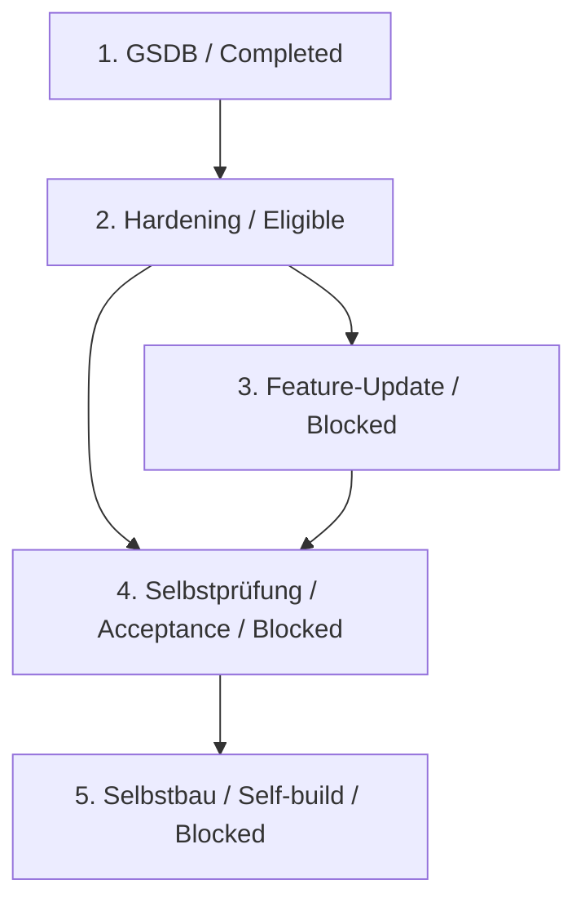

# Abarbeitungsreihenfolge der Sandbox-Intakes / Sandbox Intake Order

## Aktueller Stand / Current state — 2026-10-28

DE: Der Nutzer hat den gemeinsamen Feature-Update-Block #101/#102/#104
nach dem Container-Hardening und vor der Selbstprüfung aufgenommen.
Das Serienmanifest ist maßgeblich. Die fünf Statuswerte lauten
Completed, Eligible, Blocked, Blocked, Blocked. Eligible bedeutet nur
nächster Kandidat; keine Implementierung oder Lieferung wird gestartet.

EN: The user admitted the combined #101/#102/#104 update after container
hardening and before acceptance. The manifest is authoritative. The five
states are Completed, Eligible, Blocked, Blocked, Blocked. Eligible selects
a candidate only; it grants no implementation or delivery authority.

## Reviewstand / Review state

DE: Das viergliedrige Vollreview `5c452360-9bf7-44d9-84e0-10cae34e72ea`
vom 2026-10-27 war Ready. Die frühere Meldung „ausstehend“ war dafür
veraltet. Dieses Review und das Single-Ready des Feature-Updates nach IR701
bleiben bytegleich archiviert. Sie gelten nach Aufnahme und geändertem
Graph nicht als aktuelle Prüfung der fünfgliedrigen Reihe.
Der [neue vollständige Reviewauftrag](../../../specs/intake-review-requests/sandbox-development-lifecycle.json)
wurde nach dem bestätigten IR801-Vertrag erneuert und vollständig ausgeführt. Ergebnis: Ready (Review-ID aa89a3d1-59a0-42bb-965b-1614e3758c04). Dies ist Inhaltsbereitschaft, keine technische oder menschliche Abnahme und keine Startfreigabe.

EN: The four-member full review above was Ready on 2026-10-27; describing
that review as pending was stale. It and the feature update's post-IR701
Single Ready remain archived byte for byte. Following admission and graph
changes, neither is current acceptance of the five-member series.
The renewed complete review is Ready (review ID aa89a3d1-59a0-42bb-965b-1614e3758c04) after authorized IR801 repair. This is requirement readiness, not product/human acceptance or execution authority.

<!-- secure-development-hardening-order:start -->
## Verlinkte Lastenheft-Reihenfolge / Linked Requirements Order

DE: Jede Zeile nennt den vollständigen Dateinamen, Status und alle direkten
bindenden Vorgänger. Die Tabelle und folgende Liste sind die vollständige
Textalternative zum ergänzenden Diagramm. Spec-Kit-Feature-Zuordnungen werden
nicht aus einer Serienposition abgeleitet.

EN: Each row lists the full filename, status and all direct binding
predecessors. The table and ordered text below fully explain the diagram.
No Spec Kit feature assignment is inferred from series position.

| Position | Status | Lastenheft/Intake | Abhängigkeiten / Dependencies | Spec-Kit-Feature |
|---:|---|---|---|---|
| 1 | Completed | [Lastenheft_GSDB-Spec-Kit-Intensivpruefung.md](../../../specs/intake-authoring-archive/ec50344b-6a7b-45bf-b67c-a67f24f56c01/9d9fce68-15cc-490c-afe0-16b98eda8a54/Lastenheft_GSDB-Spec-Kit-Intensivpruefung.md) | — (Root / keine direkte Abhängigkeit) | — |
| 2 | Eligible | [Lastenheft_Secure-Development-Container-Hardening.md](../../../Lastenheft_Secure-Development-Container-Hardening.md) | [Lastenheft_GSDB-Spec-Kit-Intensivpruefung.md](../../../specs/intake-authoring-archive/ec50344b-6a7b-45bf-b67c-a67f24f56c01/9d9fce68-15cc-490c-afe0-16b98eda8a54/Lastenheft_GSDB-Spec-Kit-Intensivpruefung.md) → current (`AssessmentBaseline`, binding: true) | — |
| 3 | Blocked | [Lastenheft_Sandbox-Feature-Update-Ubuntu2604-OpenCode-Web-MSL.md](../../../Lastenheft_Sandbox-Feature-Update-Ubuntu2604-OpenCode-Web-MSL.md) | [Lastenheft_Secure-Development-Container-Hardening.md](../../../Lastenheft_Secure-Development-Container-Hardening.md) → current (`SandboxBaseline`, binding: true) | — |
| 4 | Blocked | [Lastenheft_Sandbox-Secure-Development-Selbstpruefung.md](../../../Lastenheft_Sandbox-Secure-Development-Selbstpruefung.md) | [Lastenheft_Secure-Development-Container-Hardening.md](../../../Lastenheft_Secure-Development-Container-Hardening.md); [Lastenheft_Sandbox-Feature-Update-Ubuntu2604-OpenCode-Web-MSL.md](../../../Lastenheft_Sandbox-Feature-Update-Ubuntu2604-OpenCode-Web-MSL.md) → current (jeweils / each `SandboxBaseline`, binding: true) | — |
| 5 | Blocked | [learner-fork-self-build-sandbox.md](../../../intakes/learner-fork-self-build-sandbox.md) | [Lastenheft_Sandbox-Secure-Development-Selbstpruefung.md](../../../Lastenheft_Sandbox-Secure-Development-Selbstpruefung.md) → current (`HardCompletionGate`, binding: true) | — |
<!-- secure-development-hardening-order:end -->

## Bindende Abhängigkeiten / Binding dependencies

1. Die abgeschlossene GSDB-Prüfung liefert die Baseline für das Hardening.
2. Das Feature-Update benötigt das abgeschlossene Hardening.
3. Die Selbstprüfung benötigt sowohl Hardening als auch den vollständigen
   Feature-Update-Block auf der finalen gehärteten Image-Baseline.
4. Die Selbstbau-Vorlage benötigt die erfolgreich abgeschlossene Selbstprüfung.

EN: The completed GSDB assessment supplies hardening's baseline. The update
requires completed hardening. Acceptance requires both hardening and the
complete update on the final hardened image baseline. Self-build requires
completed acceptance. All three previous binding edges are retained; the
two added edges are hardening → update and update → acceptance.



## Herkunft, Archive und Grenzen / Provenance, archives and limits

DE: Die [Aufnahmeoperation](../../../specs/intake-series-operations/1cadc99c-e344-4fc9-9fa0-78414f2d82cd.json)
bindet den Nutzerauftrag, die unveränderten Vorgänger und den neuen Graph.
Die vorherigen Manifest-/Receipt-/Reihenansichten sowie alte Reviewstände
sind archiviert. Historische Detailnachträge bleiben in diesen Archiven
erhalten; sie werden nicht als neue Ergebnisse ausgegeben.
Die frühere GSDB-Root bleibt abgeschlossen; alte Befunde und menschliche
Gates werden nicht geschlossen. Keine formelle, Produkt-, A11Y- oder
Plattformfreigabe und kein neuer autonomer Lauf.

EN: The admission operation binds user authority, exact prior artifacts and
the new graph. Prior manifest/receipt/order views and review evidence are
archived. Historical detail notes remain there; no new result is inferred.
The GSDB root stays completed, with all existing human gates retained.
No formal, product, accessibility or platform approval or autonomous run.

## Nächste fachliche Aktion / Next substantive action

DE: Das vollständige fünfgliedrige Nachreview ist Ready. Status und
Kandidatenauswahl bleiben schreibfrei; kein Befehl wird hier ausgeführt.

EN: The complete five-member re-review is Ready. Status and
candidate selection remain read-only; no command is executed here.

```text
$speckit-intake-series-next specs/intake-series/sandbox-development-lifecycle/manifest.json
```

IR801-Reparatur / IR801 repair: [Vertrag / Contract](../../../docs/maintenance/ir801-repair-2026-10-30.md). Alle fünf Statuswerte und Kanten bleiben unverändert / All five statuses and edges remain unchanged.
